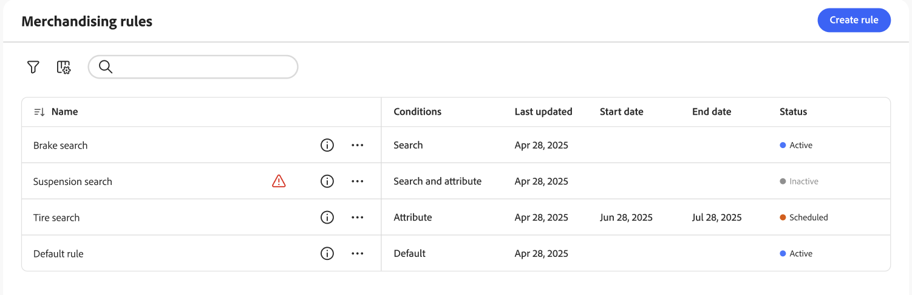

<!--
SOURCE OF TRUTH: Edit this file in the commerce.en repo:
https://github.com/Adobe-Enterprise-Docs/commerce.ko-KR/blob/main/help/_includes/ccdm-shared/merchandising/rules/workspace.md

This content is shared by the Adobe Commerce Optimizer Guide (commerce.en) and the
Merchandising Services with CCDM Guide (commerce-admin.en). Changes made in commerce.en
are synced automatically to commerce-admin.en, so do not edit the copy in that repo.
This includes related images in help/assets/ccdm-shared/.
-->

# 머천다이징 규칙 Workspace

*머천다이징 규칙* 작업 영역에서는 현재 선택한 규칙과 해당 상태를 나열하고 규칙을 만들고 관리하는 데 필요한 도구에 액세스할 수 있습니다. 모든 [카탈로그 보기](https://experienceleague.adobe.com/ko/docs/commerce/optimizer/setup/catalog-view)&#x200B;(전역) 또는 단일 카탈로그 보기로 규칙의 범위를 지정할 수 있습니다. 카탈로그 보기별로 필터링하고 카탈로그 보기별로 규칙을 만드는 방법은 [카탈로그 보기 선택](#select-catalog-view)을 참조하세요. 작업 영역에서 다음 작업을 수행할 수 있습니다.

- 규칙 검색
- 규칙 세부 사항 보기
- 규칙 활성화/비활성화
- 규칙 삭제
- 규칙 편집기 액세스

작업 공간에는 **[검색 비표시 규칙](https://experienceleague.adobe.com/ko/docs/commerce/optimizer/merchandising/rules/overview#search-suppression-rules)**&#x200B;도 포함됩니다. 동일한 규칙 관리 컨트롤을 사용하여 이러한 규칙을 편집, 예약, 활성화 또는 비활성화합니다. 쿼리 조건을 구성하고 변경 내용을 게시하려면 [검색 비표시 규칙 만들기 및 관리](https://experienceleague.adobe.com/ko/docs/commerce/optimizer/merchandising/rules/add#search-suppression-rules)를 참조하십시오. 검색 비표시 규칙에 대한 미리보기가 표시되지 않습니다.

## 열 표시/숨기기

1. 오른쪽 상단 모서리에서 **표시/숨기기** 열을 클릭합니다.

1. 메뉴에서 다음 중 하나를 수행합니다.

   - 숨겨진 열을 표시하려면 확인 표시 없이 열 이름을 클릭합니다.
   - 표시되는 열을 숨기려면 확인 표시가 있는 열 이름을 클릭합니다.

## 상태별 규칙 필터링

1. 스토어에 많은 규칙이 있는 경우 상태별로 규칙을 필터링하여 목록을 줄일 수 있습니다. 기본적으로 규칙 목록에는 모든 규칙이 표시됩니다.

1. 특정 상태 설정이 있는 규칙만 나열하려면 **상태**&#x200B;를 다음 중 하나로 설정하십시오.

   - 모두
   - 활성
   - 비활성
   - 예약됨
   - 초안

   **조건**, **시작 날짜**, **종료 날짜** 및 **마지막 업데이트**&#x200B;별로 필터링할 수도 있습니다.

## 세부 정보 보기

세부 정보 패널에는 규칙 이름, 상태, 조건 및 이벤트, 시작 및 종료 날짜, 설명 및 마지막으로 편집한 날짜가 표시됩니다. 세부 정보 패널에서 규칙을 활성화, 편집 및 삭제할 수 있습니다.

1. *머천다이징 규칙* 작업 영역에서 보려는 그리드에서 규칙을 찾아 () 아이콘을 클릭합니다.

   메뉴에서 다음 중 하나를 수행할 수 있습니다.

   - 규칙 편집
   - 규칙 삭제
   - 규칙 활성화/비활성화

## 규칙 활성화 또는 비활성화 {#enable-disable-rule}

1. *머천다이징 규칙* 작업 영역에서 규칙을 찾습니다.
1. **자세히** 열기(...) 메뉴에서 **규칙 사용** 또는 **규칙 사용 안 함**&#x200B;을 선택합니다. 세부 정보 패널에서 **사용** 컨트롤을 사용할 수도 있습니다.
1. 업데이트된 상태를 확인합니다. 향후 시작 일자가 있는 활성화된 규칙은 해당 일자까지 일정이 유지됩니다.

**검색 비표시 규칙**&#x200B;의 경우, 규칙을 비활성화하면 해당 규칙이 조건을 삭제하지 않고 일치하는 쿼리를 차단하지 못합니다. 다른 활성 제외 규칙은 여전히 이러한 쿼리를 차단할 수 있습니다. 규칙의 조건 또는 날짜를 변경하려면 **편집**&#x200B;을 선택하고 변경 내용을 검토한 다음 **저장 및 게시**&#x200B;를 클릭하십시오.

## 열 설명

| 열 | 설명 |
|--- |--- |
| 이름 | 규칙의 이름입니다. |
| 마지막으로 업데이트됨 | 규칙이 마지막으로 업데이트된 날짜입니다. |
| 시작 일자 | 예약된 규칙의 시작 날짜입니다. |
| 종료 일자 | 예약된 규칙의 종료 날짜입니다. |
| 상태 | 색상으로 구분된 상태는 규칙의 현재 상태를 나타냅니다. 그리드 위의 Status 컨트롤을 사용하여 상태별로 규칙을 필터링합니다. 값: 모든 상태 - 상태에 관계없이 모든 규칙을 표시합니다. 활성(파란색) - 활성 규칙만 표시합니다. 예약됨(주황색) - 예약된 규칙만 표시합니다. 비활성(회색) - 비활성 규칙만 표시합니다. |

## 컨트롤

| 제어 | 설명 |
|--- |--- |
| 규칙 추가 | [규칙 편집기](add.md)를 엽니다. |
| 카탈로그 보기 | 선택한 카탈로그 보기에 적용되는 규칙에 테이블을 필터링합니다. [규칙을 만들](add.md) 때도 범위를 설정합니다. 옵션: *모든 보기* 또는 특정 [카탈로그 보기](https://experienceleague.adobe.com/ko/docs/commerce/optimizer/setup/catalog-view). [카탈로그 보기 선택](#select-catalog-view)을 참조하세요. |
| 상태 | 상태별 규칙 목록을 필터링합니다. 옵션: 모두, 활성, 비활성, 예약됨 |
|  | 격자에 표시되는 열을 지정합니다. 옵션: 마지막 업데이트, 시작 날짜, 종료 날짜, 상태 |
| 검색 | 전체 이름 또는 부분 일치를 사용하여 규칙을 검색합니다. |
|  | 선택한 규칙에 적용할 수 있는 추가 작업의 메뉴를 표시합니다. 옵션: 편집, 세부 정보 보기, 삭제 |

## 규칙 세부 정보

| 필드 | 설명 |
|--- |--- |
| 상태 | 규칙의 현재 상태입니다. |
| 조건 | 규칙과 연관된 조건을 설명하는 검색 쿼리입니다. |
| 시작일 | 규칙이 적용되는 날짜(예약된 경우)입니다. |
| 종료일 | 예약된 경우 규칙이 만료되는 날짜입니다. |
| 설명 | 규칙에 대한 간단한 설명. |
| 마지막으로 업데이트됨 | 규칙이 마지막으로 업데이트된 날짜 및 시간입니다. |
| 활성화됨 | 규칙의 상태를 변경하는 컨트롤입니다. 옵션: 활성화 / 비활성화 |

## 카탈로그 보기 선택

머천다이징 규칙 페이지의 **[!UICONTROL Catalog view]** 선택기는 다음 두 가지 작업을 수행합니다.

1. **테이블을 필터링합니다** - 선택한 카탈로그 보기에 적용되는 규칙과 해당 세부 정보만 표시합니다.
1. **새 규칙에 대한 범위를 설정합니다** - [규칙을 만듭니다](add.md). 선택한 카탈로그 보기가 규칙의 범위로 사용됩니다. 옵션은 *모든 보기* 또는 특정 [카탈로그 보기](https://experienceleague.adobe.com/ko/docs/commerce/optimizer/setup/catalog-view)입니다.

   - **모든 보기** - 규칙이 모든 카탈로그 보기에 적용됩니다. 검색 및 순위 동작은 카탈로그를 사용하는 모든 상점 앞에서 동일합니다.
   - **카탈로그 보기** - 선택한 카탈로그 보기(예: 한 상점, 지역, 대리점 또는 브랜드)에만 규칙이 적용됩니다. 다른 카탈로그 보기에 다른 머천다이징 논리가 필요한 경우 사용합니다.

규칙을 만들고 범위를 설정하는 방법에 대한 자세한 내용은 [규칙 만들기 및 관리](add.md)를 참조하십시오.

### 카탈로그 보기별로 규칙을 만드는 이유는 무엇입니까?

서로 다른 상점, 지역 또는 브랜드가 서로 다른 검색 및 순위 동작을 필요로 하는 경우 카탈로그 보기당 규칙을 만듭니다. 예:

- **대리점 또는 배포자 네트워크** - 각 대리점에는 고유한 카탈로그 보기가 있습니다. 각 대리점마다 다른 고정, 증폭 또는 매몰 제품을 원할 수 있습니다.
- **다중 지역** - 지역별 머천다이징 규칙을 사용하여 EU, 미국 또는 기타 지역의 카탈로그 보기를 구분합니다.
- **여러 브랜드** - 각 브랜드에는 고유한 카탈로그 보기가 있으며 브랜드별 규칙(예: 브랜드별로 다른 기본 순위 또는 홍보된 제품)을 원하는 경우.

[인텔리전트 순위](add.md#intelligent-ranking)를 구동하는 동작 데이터(예: 가장 많이 본 순위, 가장 많이 구매한 순위, 트렌드)는 기본적으로 카탈로그 보기별로 계산됩니다. 따라서 지능형 등급을 사용하는 규칙은 해당 카탈로그 보기의 구매자 행동을 반영합니다. 계정에 카탈로그 보기 수가 많은 경우 시스템은 성능을 유지하기 위해 동작 데이터를 전체적으로 집계할 수 있습니다. 이 경우 높은 트래픽 카탈로그 보기에 따라 순위가 더 큰 영향을 받을 수 있으며 낮은 트래픽 보기의 관련성이 줄어들 수 있습니다. 현재 한도에 대해서는 [제한 및 경계](https://experienceleague.adobe.com/ko/docs/commerce/optimizer/boundaries-limits)를 참조하십시오.

### 카탈로그 보기별 규칙을 설정하는 방법

1. *머천다이징 규칙* 작업 영역에서 **[!UICONTROL Catalog view]** 드롭다운을 사용하여 규칙을 적용할 카탈로그 보기를 선택하십시오.
1. **[!UICONTROL Create rule]**&#x200B;을(를) 클릭합니다.

   만든 규칙의 범위가 선택한 카탈로그 보기로 지정됩니다.
1. [규칙 편집기](add.md)에서 규칙을 빌드합니다.

   편집기에서 규칙 유형에 적용되는 조건, 이벤트 및 세부 사항을 정의합니다. 검색 제외 규칙은 쿼리 조건을 사용하여 선택한 카탈로그 보기의 결과만 차단합니다. 카테고리 탐색, 머천다이징 페이지, 권장 사항 또는 직접 제품 URL을 통해 제품 가시성을 변경하지 않습니다.

규칙을 만든 후에는 규칙의 카탈로그 보기(범위)를 변경할 수 없습니다. 다른 카탈로그 보기에 유사한 논리를 적용하려면 새 규칙을 만들고 만들기 전에 해당 카탈로그 보기를 선택합니다.
