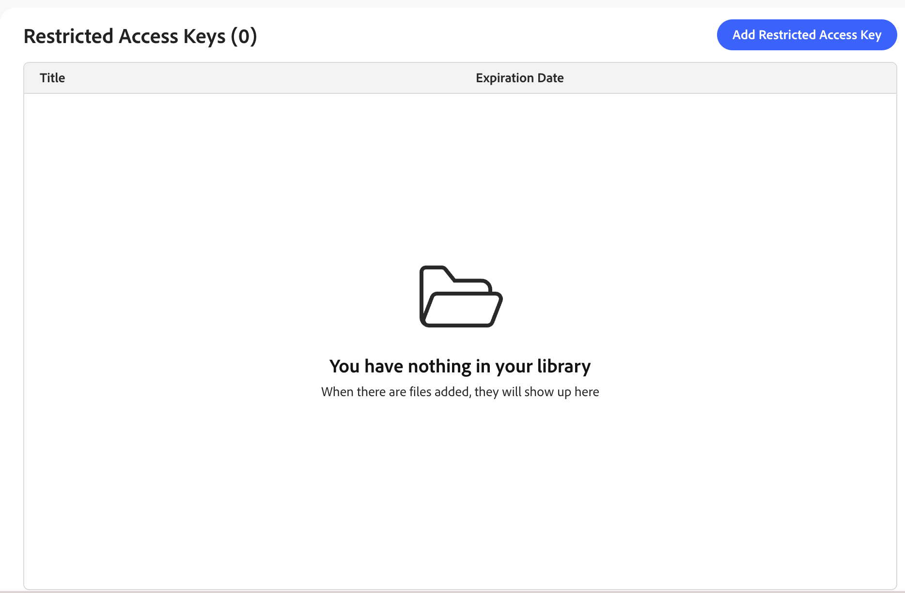
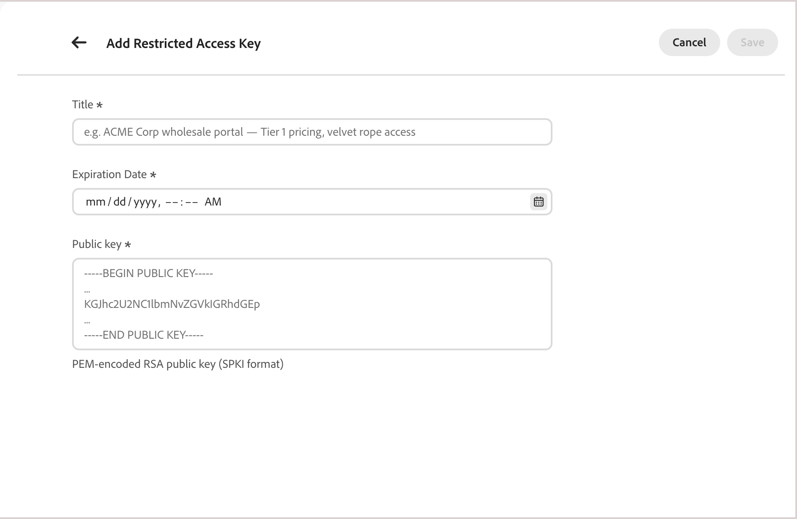

# 제한된 액세스 키

제한된 액세스 키를 사용하면 권한 있는 클라이언트 응용 프로그램에서 [개인 카탈로그 보기](private-catalog-view.md)에 액세스할 수 있습니다. 할당된 키에서 올바른 서명된 토큰을 포함하는 요청만 카탈로그 데이터를 검색할 수 있습니다. 이 카탈로그 보기에 대한 명시적 액세스 권한이 없는 쇼핑객의 요청 및 Adobe Commerce 머천다이징 서비스 API를 조사하는 스크립트를 포함한 다른 모든 요청은 거부됩니다.

제한된 액세스 키는 다음 두 가지 방법 중 하나로 제공됩니다.

- **B2B 공유 카탈로그에 대해 자동으로**—B2B 공유 카탈로그와 연결된 카탈로그 보기에 대한 초기 키를 프로비전하고 할당합니다. 그런 다음 Commerce 관리자로부터 키 및 키 할당을 관리합니다. *Commerce 관리 안내서*&#x200B;에서 [카탈로그 보기 인증](https://experienceleague.adobe.com/ko/docs/commerce-admin/b2b/shared-catalogs/catalog-views-manage)을 참조하세요. 다음 배포에서는 자동 프로비저닝을 사용할 수 있습니다.

  - Adobe Commerce B2B용 **CCDM이 포함된 Adobe Commerce as a Cloud Service**.
  - [!DNL Adobe Commerce Optimizer Connector for B2B]을(를) 통해 Adobe Commerce과 통합된 **클라우드 또는 온-프레미스**. 커넥터에 대한 B2B 확장이 필요합니다.

- **카탈로그 보기에 대해 수동으로**—파트너 포털 또는 시험판 미리 보기와 같이 카탈로그 보기를 직접 보호하려면 [제한된 액세스 키를 만듭니다](#create-a-restricted-access-key). 이 항목의 단계를 따르십시오.

## 제한된 액세스 키 사용 사례

**[!UICONTROL Price Book ID]**&#x200B;은(는) 요청을 볼 수 있는 가격을 결정합니다. 가격책정은 누가 만들지 않습니다. 카탈로그 보기의 ID 및 가격 장부 ID를 알고 있는 모든 클라이언트는 머천다이징 Services API를 통해 해당 데이터를 검색할 수 있습니다. 제한된 액세스 키는 별도의 보완 제어를 추가합니다. 이들은 적용되는 가격 장부에 관계없이 카탈로그 보기에 액세스할 수 있는 사용자의 범위를 지정합니다.

제한된 액세스 키는 일반적으로 다음에 사용됩니다.

- **계약 기반 B2B 가격 책정**—협상된 가격 장부에 연결된 카탈로그 보기를 제한하여 구매자만 이를 쿼리할 수 있도록 합니다. 다른 구매 조직과 대중은 할 수 없습니다. B2B 공유 카탈로그의 경우 자동으로 설정됩니다. [키 관리 및 순환](#key-management-and-rotation)을 참조하세요.
- **파트너 및 리셀러 포털** - 머천다이징 서비스 API와 직접 통합하는 승인된 파트너로 카탈로그 하위 집합을 제한합니다.
- **프리릴리스 미리 보기** - 신뢰할 수 있는 내부 또는 파트너 시스템에서 예정된 제품을 공개하기 전에 미리 볼 수 있습니다.

## 제한된 액세스 키 작동 방식

제한된 액세스 키는 RSA 키 쌍의 공개 구성 요소입니다. 클라이언트 애플리케이션은 이 키를 생성하여 사용하여 개인 카탈로그 보기를 읽을 수 있는 권한을 부여합니다. 이 컨텍스트에서 _클라이언트 응용 프로그램_&#x200B;은(는) 상점 프런트 엔드 자체가 아닌 쇼핑객(예: [!DNL Adobe Commerce]의 사용자 지정 논리 또는 타사 백엔드)을 인증하는 백 엔드 시스템을 참조합니다.

다음 단계에서는 키 쌍과 서명된 토큰이 B2B 공유 카탈로그의 일부가 아닌 카탈로그 보기에 대한 만들기에서 유효성 검사로 이동하는 방법을 설명합니다.

1. 클라이언트 애플리케이션은 RSA 키 쌍을 생성하고 개인 키를 유지합니다.
1. 시스템에서 **공개** 키를 제한된 액세스 키로 등록했습니다.
1. 클라이언트 애플리케이션은 개인 키로 JSON 웹 토큰(JWT)에 서명하고 개인 카탈로그 보기에 대한 각 요청과 함께 이 토큰을 포함합니다.

   시스템은 등록된 공개 키에 대해 토큰의 서명을 확인하고, 유효한 경우 요청된 카탈로그 데이터를 반환합니다.

## 제한된 액세스 키 작업 공간 액세스

제한된 액세스 키 작업 영역을 여는 방법은 사용하는 제품에 따라 다릅니다.

- **Adobe Commerce 관리자**(Adobe Commerce as a Cloud Service) - *시스템* > *데이터 전송* > **제한된 액세스 키**&#x200B;를 선택합니다.
- **Adobe Commerce Optimizer Studio**—*스토어 설정* > **제한된 액세스 키**&#x200B;를 선택합니다.

## 제한된 액세스 키 만들기

>[!NOTE]
>
>이 섹션과 다음 두 섹션에서는 제한된 액세스 키를 관리하는 수동 프로세스에 대해 설명합니다. 자동 키 프로비저닝이 있는 B2B 공유 카탈로그의 경우 Commerce 관리자의 키를 관리합니다. [제한된 액세스 키](https://experienceleague.adobe.com/ko/docs/commerce-admin/systems/data-transfer/data-sync/catalog-view-sync/restricted-access-keys)를 참조하세요.

### 제한된 액세스 키 추가

키를 관리하는 데 사용하는 도구의 탭(Commerce Admin 또는 Adobe Commerce Optimizer Studio)을 선택합니다.

>[!BEGINTABS]

>[!TAB Adobe Commerce 관리자]

CCDM과 함께 Adobe Commerce as a Cloud Service 또는 커넥터를 통해 Adobe Commerce에 연결된 Adobe Commerce Optimizer을 사용하는 고객은 Commerce 관리자로부터 RSA 키 쌍을 생성할 수 있습니다. [제한된 액세스 키 관리](https://experienceleague.adobe.com/ko/docs/commerce-admin/systems/data-transfer/data-sync/catalog-view-sync/restricted-access-keys)를 참조하십시오.

>[!TAB Adobe Commerce Optimizer Studio]

Adobe Commerce Optimizer Studio를 사용하는 고객은 자체 RSA 키 쌍을 생성 및 관리한 다음 공개 키를 시스템에 추가해야 합니다. 타사 백엔드가 있는 Adobe Commerce Optimizer에 필요한 워크플로우입니다. 커넥터를 사용하는 고객은 Commerce 관리자 대신 이 워크플로우를 사용할 수도 있습니다.

**RSA 키 쌍 생성**

개인 카탈로그 보기의 초기 테스트를 수행하려면 [!DNL OpenSSL]과(와) 같은 도구를 사용하여 키 쌍을 생성하십시오. 개인 키 비밀을 유지하십시오. 공개 키만 제한된 액세스 키로 시스템에 업로드됩니다.

```bash
openssl genrsa -out private-key.pem 2048
openssl rsa -in private-key.pem -pubout -out public-key.pem
```

키 크기는 2048비트와 8192비트 사이여야 합니다. `public-key.pem`에 아래 **[!UICONTROL Public key]** 필드에 붙여 넣은 값이 있습니다.

**공개 키를 시스템에 추가**

1. 제한된 액세스 키 작업 영역에서 **[!UICONTROL Add Restricted Access Key]**&#x200B;을(를) 클릭합니다.

   {width="70%" zoomable="yes"}

1. 주요 세부 정보 입력:

   {width="70%" zoomable="yes"}

   - **[!UICONTROL Title]** - 키 목록 및 카탈로그 보기 키 선택기에 표시되는 키를 식별하는 레이블입니다(예: `ACME Corp wholesale portal — Tier 1 pricing`).
   - **[!UICONTROL Expiration date]**—아직 만료되지 않은 토큰의 경우에도 키 사용이 중지되는 날짜 및 시간(UTC).
   - **[!UICONTROL Public key]** - `-----BEGIN PUBLIC KEY-----` 및 `-----END PUBLIC KEY-----` 마커를 포함하여 SPKI(주체 공개 키 정보) 형식의 PEM 인코딩 RSA 공개 키입니다. 환경 전체에서 고유해야 합니다.

1. **[!UICONTROL Save]**&#x200B;을(를) 클릭합니다.

>[!ENDTABS]

키를 만든 후에는 변경할 수 없습니다. 값을 변경하려면 키를 삭제하고 새 값을 만듭니다. 액세스 중단 없이 이 작업을 수행하려면 [키 회전](#rotate-a-key)을 참조하십시오.

## 카탈로그 보기에 키 할당

제한된 액세스 키는 **[!UICONTROL Catalog Protection]**&#x200B;이(가) 활성화된 카탈로그 보기에 할당된 후에만 액세스를 인증합니다. 설치 단계는 [카탈로그 보기 보호](private-catalog-view.md#protect-a-catalog-view)를 참조하십시오.

## 키 삭제

1. **[!UICONTROL Restricted access keys]** 작업 영역에서 제거할 키를 찾아 삭제합니다.

   하나 이상의 카탈로그 보기에 키를 할당하면 해당 키를 사용하는 클라이언트 응용 프로그램에 대한 액세스 권한이 상실된다는 경고가 표시됩니다. 카탈로그 뷰 자체는 보호되어 있으므로 공개적으로 액세스할 수 없습니다.

1. 삭제를 확인합니다.

## 키 관리 및 순환

제한된 액세스 키는 카탈로그 보호를 사용하는 방법에 따라 다음 두 가지 방법 중 하나로 관리됩니다.

- **B2B 공유 카탈로그에 대해 자동으로**—CCDM을 통해 머천다이징 서비스를 사용하는 Adobe Commerce B2B 배포와 [!DNL Adobe Commerce Optimizer Connector for B2B]&#x200B;(B2B 확장 필요)을 통해 통합된 Adobe Commerce Optimizer 배포의 경우 카탈로그 보기가 만들어질 때 서비스가 자동으로 첫 번째 제한된 액세스 키를 생성하고 할당합니다. 각 카탈로그 보기는 자체 키를 받습니다. 그런 다음 공유 카탈로그 또는 회사 계정 페이지에서 각 키를 관리할 수 있습니다. Commerce 관리 **제한된 액세스 키** 페이지(**시스템** > **데이터 전송**)에서 키를 보고 관리할 수도 있습니다. [카탈로그 보기 구성 관리](https://experienceleague.adobe.com/ko/docs/commerce-admin/b2b/shared-catalogs/catalog-views-manage)를 참조하세요.

  공유 카탈로그와 스토어 보기의 각 조합은 별도의 카탈로그 보기로 표시됩니다. 투영은 해당 조합에 대해 머천다이징 서비스 데이터 계층으로 내보내는 카탈로그 보기, 정책, 가격 장부 참조 및 제한된 액세스 키 구성 데이터입니다. 따라서 여러 저장소 보기에 할당된 공유 카탈로그는 각각 고유한 키를 가진 여러 카탈로그 보기를 생성합니다. 다른 항목에 영향을 주지 않고 한 카탈로그 보기에 대한 키를 편집하거나 회전합니다.

  키는 기본적으로 만료 기간이 깁니다. 키를 회전해야 하는 경우 관리자에서 교체를 추가하고 이전 키를 제거할 때까지 두 키를 모두 활성 상태로 유지합니다.

- **모든 카탈로그 보기에 대해 수동으로**—키를 생성하고 관리하는 방법은 제품 컨텍스트에 따라 다릅니다. 두 경우 모두 쇼핑객을 인증하는 백엔드 클라이언트가 토큰에 서명합니다.

  - **Commerce 관리자(CCDM이 있는 Adobe Commerce as a Cloud Service 또는 커넥터가 있는 Adobe Commerce Optimizer)** - Commerce 관리에서 RSA 키 쌍을 생성하고 **제한된 액세스 키** 페이지에서 키를 만들고, 할당하고, 삭제합니다. Adobe Commerce은 키를 자동으로 회전하지 않습니다. 키를 회전하려면 [키 회전](#rotate-a-key)을 참조하세요.
  - **Adobe Commerce Optimizer Studio**—Studio에서 키를 생성하지 않습니다. 타사 백엔드가 있는 Adobe Commerce Optimizer에 필요한 워크플로우이며 커넥터 고객이 사용할 수도 있습니다. 클라이언트 응용 프로그램을 사용하여 RSA 키 쌍을 생성하고 개인 키를 유지한 다음 공개 키를 제한된 액세스 키로 추가합니다. 이 항목의 앞 단계를 사용하여 키를 만들고, 추가하고, 삭제합니다. 키를 회전하려면 [키 회전](#rotate-a-key)을 참조하세요.

### 키 회전

액세스 중단 없이 키를 회전하려면 카탈로그 보기에서 최대 3개의 키를 한 번에 할당할 수 있습니다.

키를 관리하는 데 사용하는 도구의 탭(Commerce Admin 또는 Adobe Commerce Optimizer Studio)을 선택합니다.

>[!BEGINTABS]

>[!TAB Adobe Commerce 관리자]

[키 선택 및 순환](https://experienceleague.adobe.com/ko/docs/commerce-admin/systems/data-transfer/data-sync/catalog-view-sync/restricted-access-keys#key-selection-and-rotation)을 참조하세요. 이는 CCDM이 포함된 Adobe Commerce as a Cloud Service 및 Adobe Commerce Optimizer 커넥터를 통해 Adobe Commerce Optimizer과 통합된 Adobe Commerce 프로젝트에 적용됩니다.

>[!TAB Adobe Commerce Optimizer Studio]

이 절차는 서드파티 백엔드가 있는 Adobe Commerce Optimizer에 필요합니다. 커넥터를 사용하는 고객은 Commerce 관리자 대신 커넥터를 사용할 수도 있습니다.

1. 새 키 쌍을 생성하고 새 공개 키를 새 제한된 액세스 키로 추가합니다.
1. 기존 키와 함께 새 키를 카탈로그 보기에 할당합니다.
1. 새 개인 키로 새 토큰에 서명을 시작하여 키 롤오버를 완료합니다.
1. 새 키에서 모든 클라이언트 응용 프로그램이 확인되면 이전 키를 제거하고 삭제합니다.

>[!ENDTABS]

## 제한

[카탈로그 보기 및 정책 제한](https://experienceleague.adobe.com/ko/docs/commerce/optimizer/boundaries-limits)을 참조하세요.

## 다음과 같음

- [비공개 카탈로그 보기](private-catalog-view.md)—제한된 액세스 키로 카탈로그 보기를 보호하는 방법에 대해 알아봅니다.

