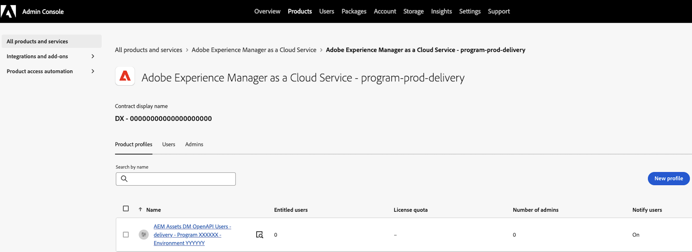

# 사용자 권한 및 IMS

**IMS**(Adobe Identity Management 시스템)이 인증 계층입니다.

* Adobe Commerce as a Cloud Service의 경우 관리자는 기본적으로 IMS 인증을 활성화합니다.
* 클라우드 또는 온프레미스의 Adobe Commerce에서 IMS는 선택 사항입니다.

  [Commerce용 IMS 사용](https://experienceleague.adobe.com/en/docs/commerce-admin/start/admin/ims/adobe-ims-config){target=_blank}은(는) 자산 선택기와 환경 및 도메인 드롭다운을 통해 향상된 구성 UI를 제공합니다. 구성에 별도의 **프로그램 ID** 및 **환경 ID** 필드가 표시되면 IMS 없이 해당 식별자를 수동으로 입력할 수 있습니다.

IMS를 사용하는 경우 AEM Assets 통합에도 특정 **Adobe Admin Console 제품 프로필**&#x200B;이 필요합니다. Commerce 관리에서 통합을 구성하는 사용자는 **AEM Assets DM OpenAPI 사용자 - 게재** 제품 프로필 또는 **작성자** 제품 프로필이 대체 항목으로 필요합니다. 이 액세스는 사용자의 IMS 조직에서 Admin Console 제품 프로필을 통해 제어되며 다음을 활성화합니다.

* **자산 선택기**&#x200B;를 사용하면 범주 이미지 또는 Page Builder 콘텐츠를 관리할 때 AEM Assets에서 이미지를 선택할 수 있습니다.
* 사용자의 IMS 세션에서 값을 가져오는 **자동으로 채워진 구성 필드**(**AEM 환경** 및 **AEM 도메인 매핑** 드롭다운 포함). 환경 선택 및 수동 ID 항목에 대해서는 [통합 구성](setup-synchronization.md)을 참조하십시오.

올바른 권한이 없으면 에셋 선택기를 사용할 수 없으며, 이러한 필드는 비어 있거나 수동으로 입력해야 합니다.

>[!IMPORTANT]
>
> Adobe Admin Console 제품 프로필은 통합 기능에 대한 사용자 액세스를 제어합니다. 라이선스 권한은 변경되지 않습니다. 작성자 제품 프로필을 할당해도 AEM Assets 작성자 API 액세스 권한이 제품 시각적 개체 고객에게 부여되지 않습니다. 권한 요구 사항은 [제품 시각적 개체 제한](../../optimizer/boundaries-limits.md#product-visuals-limits)을 참조하세요.

>[!BEGINSHADEBOX]

**IMS와 권한이 상호 작용하는 방법**

Adobe IMS는 사용자 ID와 조직 컨텍스트를 제공하는 반면 Adobe Admin Console은 보유하고 있는 **제품 프로필**(권한)을 정의합니다. AEM Assets 통합은 IMS 세부 정보와 할당된 프로필을 사용하여 구성 필드를 자동으로 채우고 에셋 선택기를 활성화할 수 있는지 여부를 결정합니다.

>[!ENDSHADEBOX]

## 제품 프로필이 필요한 이유

통합은 프로필에 매핑된 도메인만 로드할 수 있습니다. 따라서 사용자는 다음 제품 프로필을 보유할 수 있습니다.

* **AEM 배달 제품 프로필**. 사용자에게 작성자 및 게재 프로필이 모두 있는 경우 에셋 선택기 및 구성 UI에 필요합니다. 가능한 경우 통합에서 AEM 게재 제품 프로필을 사용합니다.

* **작성자 제품 프로필**. AEM Assets UI에 액세스하는 데 필요합니다. 또한, 사용자에게 Admin Console에 AEM 게재 제품 프로필이 없는 경우 에셋 선택기 및 구성 UI에 대한 대체 역할을 합니다.

통합은 사용 가능한 경우 **AEM 게재 제품 프로필**&#x200B;에서 환경 및 도메인 매핑을 로드하거나, AEM 게재 제품 프로필이 사용자의 Admin Console에 없는 경우 **작성자 제품 프로필**(으)로 돌아갑니다. 다음과 같은 작업을 수행하려면 다음 프로필 중 하나가 필요합니다.

* Commerce 관리 구성에서 **AEM 환경** 및 **AEM 도메인 매핑** 드롭다운을 채웁니다.
* 에셋 선택기를 사용하여 AEM Assets에서 에셋을 찾아보고 선택합니다.

두 프로필 모두 구성되지 않은 경우 자산 선택기를 사용할 수 없습니다. 구성에 별도의 **프로그램 ID** 및 **환경 ID** 필드가 표시되면 식별자를 수동으로 입력할 수 있습니다.

## 배포 유형별 권한 부여

>[!BEGINTABS]

>[!TAB Adobe Commerce as a Cloud Service]

[!BADGE SaaS만]{type=Positive tooltip="Adobe Commerce as a Cloud Service 및 Adobe Commerce Optimizer 프로젝트에만 적용됩니다(Adobe 관리 SaaS 인프라)."}

시스템은 기본적으로 IMS 인증을 활성화합니다.

[AEM Assets](https://adminconsole.adobe.com/)의 **Adobe Admin Console DM OpenAPI 사용자 - 게재** 제품 프로필 또는 **작성자** 제품 프로필에 사용자를 대체 항목으로 추가합니다.

>[!NOTE]
>
> Commerce 및 AEM Assets에도 사용자를 추가해야 합니다. 전체 설정에 대해서는 _사용자 및 Identity Management_ 안내서에서 [AEM Assets 또는 제품 비주얼에 사용자 추가](https://experienceleague.adobe.com/en/docs/commerce/cloud-service/user-management#add-a-user-to-aem-assets-or-product-visuals){target=_blank}를 참조하십시오.

{width="600" zoomable="yes"}

>[!TAB 클라우드 또는 온-프레미스의 Adobe Commerce]

[!BADGE PaaS만]{type=Informative tooltip="Adobe Commerce on Cloud 프로젝트에만 적용됩니다(Adobe 관리 PaaS 인프라)."}

자산 선택기를 사용하려면 PaaS에 **IMS 클라이언트 ID**&#x200B;가 필요합니다. OpenAPI를 사용하여 Dynamic Media를 활성화할 때 IMS 클라이언트 ID를 가져오는 방법을 포함한 필수 구성 요소는 [AEM Assets 프로젝트 구성](configure-aem.md#prerequisites)을(를) 참조하십시오.

에셋 선택기와 **AEM 환경** 및 **AEM 도메인 매핑** 드롭다운을 사용하려면:

1. [Commerce에서 Adobe IMS를 사용하도록 설정](https://experienceleague.adobe.com/en/docs/commerce-admin/start/admin/ims/adobe-ims-config){target=_blank}하여 Commerce 관리자가 IMS 인증을 사용하고 사용자의 Admin Console 제품 프로필을 읽을 수 있도록 합니다.

1. 자산 선택기에 대한 사용자 지정 IMS 클라이언트 ID를 요청하려면 [지원 티켓을 엽니다](https://experienceleague.adobe.com/en/docs/support-resources/adobe-support-tools-guide/adobe-commerce-support/adobe-commerce-help-center-user-guide#support-case).

1. [Adobe Admin Console](https://adminconsole.adobe.com/)에서 사용자를 **AEM Assets DM OpenAPI 사용자 - 게재** 제품 프로필 또는 **작성자** 제품 프로필에 대체 항목으로 추가합니다.

별도의 프로그램 ID 및 환경 ID 필드를 표시하는 구성의 경우 IMS 없이 수동으로 입력할 수 있습니다. [통합 구성](setup-synchronization.md)을 참조하십시오.

>[!ENDTABS]

## 관련 설명서

* [AEM Assets 통합에 대한 IMS 사용자 권한 구성](setup-synchronization.md) - Commerce을 AEM Assets에 연결하고 일치하는 규칙을 구성합니다.
* [수동 자산 선택](../synchronize/asset-selector-integration.md) - 범주 이미지 및 페이지 빌더에 자산 선택기를 사용합니다.
* [AEM Assets 또는 제품 비주얼에 사용자 추가](https://experienceleague.adobe.com/en/docs/commerce/cloud-service/user-management#add-a-user-to-aem-assets-or-product-visuals){target=_blank} - [!DNL Adobe Commerce as a Cloud Service]의 경우 먼저 Commerce 및 AEM Cloud Manager(비즈니스 소유자, 배포 관리자)에 사용자를 추가하십시오. **AEM Assets DM OpenAPI 사용자 - 게재** 프로필(또는 **작성자** 프로필을 대체 프로필)은 자산 선택기와 자동 채우기 기능에 대한 추가 요구 사항입니다.
* [팀원을 AEM 배달 계층에 할당](https://experienceleague.adobe.com/en/docs/experience-manager-cloud-service/content/onboarding/journey/assign-profiles-aem#add-team-members){target=_blank}. 게재 액세스를 위한 AEM 설명서.

