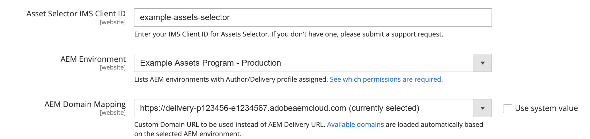

# 통합 구성

Commerce을 AEM Assets 인스턴스에 연결하고 에셋 동기화를 위한 일치 전략을 선택하여 통합을 구성합니다.

AEM Assets 프로젝트를 식별한 후 Adobe Commerce과 AEM Assets 간에 자산을 동기화하기 위한 일치 규칙을 선택합니다.

* **[!UICONTROL Match by product SKU]** - 에셋이 올바른 제품과 연결되어 있는지 확인하기 위해 에셋 메타데이터의 SKU와 [Commerce 제품 SKU](https://experienceleague.adobe.com/en/docs/commerce-operations/implementation-playbook/glossary#sku)가 일치하는 기본 규칙입니다.

* **[!UICONTROL Custom match]** - 사용자 지정 일치 논리가 필요한 더 복잡한 시나리오 또는 특정 비즈니스 요구 사항에 대한 일치 규칙. 사용자 지정 일치를 구현하려면 Adobe Developer App Builder에서 자산과 제품의 일치 방법을 정의하는 사용자 지정 코드를 개발해야 합니다. [사용자 지정 자동 일치](../synchronize/custom-match.md)를 참조하십시오.

초기 설정의 경우 기본 **[!UICONTROL Match by product SKU]** 규칙을 사용합니다.

## 요구 사항

AEM Assets 통합을 구성하기 전에 다음 단계를 완료했는지 확인하십시오.

* [AEM Assets 프로젝트 구성](configure-aem.md)

* [!BADGE PaaS만 해당]{type=Informative tooltip="Adobe Commerce on Cloud 프로젝트에만 적용됩니다(Adobe 관리 PaaS 인프라)."} [Adobe Commerce 패키지를 설치하여](configure-commerce.md) 확장을 추가하고 확장을 사용하는 데 필요한 자격 증명과 연결을 생성합니다.

* [사용자 권한 및 IMS](permissions.md) - 에셋 선택기, AEM 환경 선택 및 도메인 매핑에 필요한 권한을 구성합니다.

## 연결 구성

{width="900" zoomable="yes"}

1. Commerce 관리자에서 **[!UICONTROL Stores]** > **[!UICONTROL Settings]** > **[!UICONTROL Configuration]** > **[!UICONTROL ADOBE SERVICES]** > **[!UICONTROL AEM Assets Integration]**(으)로 이동합니다.

>[!INFO]
>
> AEM Assets 통합은 글로벌(기본) 범위에서만 구성을 지원합니다. 웹 사이트 수준 구성은 지원되지 않습니다. 웹 사이트 수준에서 통합을 구성하려고 하면 시스템이 웹 사이트 수준 설정을 무시하고 대신 전역 구성 값을 사용합니다.

1. [!BADGE PaaS만]{type=Informative tooltip="Adobe Commerce on Cloud 프로젝트에만 적용됩니다(Adobe 관리 PaaS 인프라)."} **[!UICONTROL Asset Selector IMS Client ID]**&#x200B;을(를) 입력하십시오.

   이 ID는 자산 선택기를 활성화하는 데 필요합니다. 이 ID를 얻으려면 [사용자 권한 및 IMS](permissions.md)를 참조하십시오. 자산 선택기에 대한 자세한 내용은 [자산 수동으로 선택](../synchronize/asset-selector-integration.md)을 참조하십시오.

1. **[!UICONTROL AEM Environment]**&#x200B;에서 [AEM Assets 프로젝트 구성](configure-aem.md)에 구성된 환경을 선택하십시오.

   이 목록에는 사용자에게 작성자 또는 게재 제품 프로필이 있는 AEM 환경이 포함되어 있습니다. 필요한 환경이 누락된 경우 [사용자 권한 및 IMS](permissions.md)를 검토하십시오.

   구성에 별도의 **[!UICONTROL Program ID]** 및 **[!UICONTROL Environment ID]** 필드가 대신 표시되는 경우 해당 환경에 대한 식별자를 지정하십시오. 수동으로 입력하려면 AEM Cloud Manager에서 복사하거나 작성자 URL `https://author-p<ProgramID>-e<EnvironmentID>.adobeaemcloud.com/`에서 파생하십시오. `p` 및 `e` 접두사 없이 숫자 식별자만 입력하십시오.

   **[!UICONTROL Use system value]** 확인란이 있는 필드의 경우 기본값을 재정의하기 전에 선택을 취소하십시오.

1. **[!UICONTROL AEM Domain Mapping]** 확인. 사용 가능한 도메인은 선택한 AEM 환경을 기반으로 자동으로 로드됩니다. 프로젝트에서 사용자 지정 자산 전달 도메인을 사용하는 경우 [사용자 지정 도메인 URL 구성](#optional-configure-the-custom-domain-url)을 따르십시오.

1. [!BADGE PaaS만 해당]{type=Informative tooltip="Adobe Commerce on Cloud 프로젝트에만 적용됩니다(Adobe 관리 PaaS 인프라)."} Commerce과 자산 일치 서비스 간 요청을 인증하기 위해 [[!UICONTROL Commerce integration]](configure-commerce.md#add-the-integration-to-the-commerce-environment)을(를) 선택합니다.

1. Commerce이 AEM Assets에서 들어오는 업데이트를 수락하도록 하려면 **[!UICONTROL Synchronization enabled]**&#x200B;을(를) `Yes`(으)로 설정하십시오.

   통합을 활성화한 후 에셋 일치 기준을 지정하는 추가 구성 옵션을 사용할 수 있습니다.

1. **[!UICONTROL Asset matching rule]** 드롭다운에서 자산 동기화에 대한 자산 일치 규칙 중 하나를 선택합니다.

   * [기본 자동 일치](../synchronize/default-match.md)에 대해 **[!UICONTROL Match by product SKU]**&#x200B;을(를) 선택하십시오.
   * [사용자 지정 자동 일치](../synchronize/custom-match.md)에 대해 **[!UICONTROL Custom match]**&#x200B;을(를) 선택하십시오. 이 옵션을 사용하려면 [Adobe Developer App Builder](https://experienceleague.adobe.com/en/docs/commerce-learn/tutorials/extensibility/adobe-developer-app-builder/introduction-to-app-builder)이(가) 필요합니다.

1. **[!UICONTROL Match by product SKU]**&#x200B;의 경우 **[!UICONTROL Match by product SKU attribute name]** 필드에 [AEM Assets 메타데이터 속성 이름](../metadata.md)을 입력하십시오. 기본값은 `commerce:skus`입니다.

   제품 SKU 값이 아닌 속성 이름을 입력합니다. [기본 자동 일치](../synchronize/default-match.md)에 설명된 대로 실제 제품 SKU를 AEM Assets에 있는 각 자산의 **[!UICONTROL Product Data]** 메타데이터에 추가합니다.

1. [시각화 소유자](#configure-the-visualization-owner) 설정을 검토하십시오. 마이그레이션하는 동안 자산 동기화가 완료될 때까지 **Adobe Commerce** 소유권을 유지합니다.

1. 업데이트를 적용하고 자산 동기화를 시작하려면 **[!UICONTROL Save Config]**&#x200B;을(를) 선택하십시오.

   구성 업데이트는 초기 동기화 프로세스를 트리거하여 Commerce에서 AEM Assets의 수신 업데이트를 수락할 수 있습니다. 동기화에 필요한 시간은 에셋의 볼륨과 특정 구성에 따라 다릅니다. 통합은 자동화된 프로세스를 활용하여 동기화에 필요한 시간을 최소화합니다.

### 동기화 SLA

통합을 위한 service level agreement(SLA)는 다음과 같은 동기화 성능 수준을 보장합니다.

* `< 5 minutes for 99% of updates`

* `< 30 minutes for 99.9% of updates`

이러한 수준의 서비스를 통해 제품 페이지에는 항상 최신 이미지가 표시되므로 상점 컨텐츠가 정확하고 시각적으로 매력적입니다.

## 현지화된 대체 텍스트 동기화

현지화된 대체 텍스트는 기존 에셋 동기화 프로세스를 사용합니다. 새 이벤트 유형이나 별도의 동기화 구성은 필요하지 않습니다.

1. AEM 에셋의 **[!UICONTROL Commerce]** 탭에서 스토어-보기 대체 텍스트 행을 하나 이상 추가합니다.

1. 자산을 Commerce 제품 SKU와 연결합니다.

1. AEM Assets에서 에셋을 승인합니다.

1. 자산 이벤트 및 동기화 프로세스가 완료될 때까지 기다립니다.

1. Commerce 관리 및 상점 응답에서 지역화된 값을 확인합니다.

필드 이름, 유효성 검사 규칙 및 Commerce 결과에 대해서는 [AEM Assets의 Commerce 메타데이터](../metadata.md)를 참조하십시오.

## 시각화 소유자 구성

**시각화 소유자** 설정은 통합에서 제품 이미지를 제공하는 시스템을 결정합니다.

* Adobe Commerce - Commerce에서 호스팅된 이미지를 사용합니다.

* AEM Assets - AEM에서 동기화된 이미지를 사용합니다.

관리자는 해당 소유자에게 사용 가능한 이미지를 표시하지만 나머지 이미지는 회색으로 표시되며 **hidden** 레이블과 함께 표시됩니다.

이미지 표시 동작에 대한 자세한 내용은 [이미지 세부 정보 설정](https://experienceleague.adobe.com/en/docs/commerce-admin/catalog/products/digital-assets/product-image#set-image-details){target=_blank} 항목을 참조하십시오.

>[!TIP]
>
> Commerce에서 AEM Assets으로 마이그레이션하는 동안 끊어진 이미지 링크를 방지하려면 **시각화 소유자**&#x200B;를 Commerce으로 설정하십시오. 모든 제품이 AEM Assets과 성공적으로 동기화되면 AEM Assets 소유자로 전환하여 전환을 완료합니다. 이를 통해 프로세스 전체에서 지속적인 이미지 가용성을 보장합니다.

1. **[!UICONTROL Stores]** > **[!UICONTROL Settings]** > **[!UICONTROL Configuration]** > **[!UICONTROL ADOBE SERVICES]** > **[!UICONTROL AEM Assets Integration]**(으)로 이동합니다.

   {width="700" zoomable="yes"}

1. 이미지를 표시할 **시각화 소유자** 원본을 선택하십시오.

1. 업데이트를 적용하려면 **[!UICONTROL Save Config]**&#x200B;을(를) 클릭하십시오.

   **AEM Assets**(으)로 전환하기 전에 [자산이 예상 제품과 연결되어 있는지 확인](#verify-the-integration)하십시오. 그런 다음 AEM Assets 제품 이미지를 표시하도록 [상점 구성을](configure-storefront.md)하십시오.

## 선택 사항입니다. 사용자 정의 도메인 URL 구성

AEM Assets as a Cloud Service 프로젝트가 [사용자 지정 도메인 이름](https://experienceleague.adobe.com/ko/docs/experience-manager-cloud-service/content/implementing/using-cloud-manager/custom-domain-names/add-custom-domain-name){target=_blank}(으)로 구성된 경우 Commerce용 AEM Assets 통합에서 사용할 수 있도록 도메인 이름을 Commerce 저장소 구성에 추가해야 합니다.

AEM 관리자로부터 구성된 에셋 전달 사용자 정의 도메인 URL을 가져옵니다. 이 설정은 AEM 게재 URL을 대체합니다. 프로그램 ID와 환경 ID를 식별하는 데 사용되는 AEM 작성자 URL은 아닙니다. 프로젝트에서 사용자 정의 도메인을 사용하지 않는 경우에는 도메인 매핑을 변경하지 않고 그대로 둡니다.

>[!NOTE]
>
>사용자 정의 도메인 URL을 구성해도 이전에 동기화된 에셋의 URL은 업데이트되지 않습니다. 이러한 자산은 [AEM Assets에서 다시 처리](https://experienceleague.adobe.com/en/docs/experience-manager-cloud-service/content/assets/manage/reprocessing){target=_blank}될 때까지 이전 URL을 유지합니다. 사용자 정의 도메인 구성을 저장한 후 이러한 에셋을 재처리하여 해당 URL을 업데이트하여 사용자 정의 도메인을 사용합니다.

1. **[!UICONTROL Stores]** > **[!UICONTROL Settings]** > **[!UICONTROL Configuration]** > **[!UICONTROL ADOBE SERVICES]** > **[!UICONTROL AEM Assets Integration]**(으)로 이동합니다.

1. 선택한 **[!UICONTROL AEM Environment]**&#x200B;을(를) 확인한 다음 **[!UICONTROL AEM Domain Mapping]**&#x200B;에서 구성된 사용자 지정 도메인을 선택합니다. 사용 가능한 도메인은 선택한 환경에 대해 자동으로 로드됩니다.

{width="700" zoomable="yes"}

    **[!UICONTROL Asset Custom Domain]** 텍스트 필드를 대신 표시하는 구성의 경우 해당 필드에 사용자 지정 도메인 URL을 입력하십시오.

1. 업데이트를 적용하려면 **[!UICONTROL Save Config]**&#x200B;을(를) 클릭하십시오.

## 통합 확인

>[!NOTE]
>
>Adobe Commerce Optimizer에 동기화 상태를 사용할 수 없습니다. 아래 Commerce 관리자 검사 대신 [Commerce Optimizer 확인 워크플로](configure-aco.md#match-by-sku-workflow-example)를 따르십시오.

1. 기존 Commerce 제품을 선택하고 SKU를 확인합니다.

1. AEM Assets에서 테스트 자산을 **[!UICONTROL Eligible for Commerce]**(으)로 표시하고 해당 제품 SKU와 연결하고 역할 및 위치를 설정합니다. 자산을 승인합니다. [기본 자동 일치](../synchronize/default-match.md)를 참조하거나 구성된 [사용자 지정 일치 규칙](../synchronize/custom-match.md)을 사용하십시오.

1. 동기화가 완료되면 Commerce 관리에서 제품을 열고 **[!UICONTROL Images And Videos]** 섹션에서 관련 에셋, 역할 및 위치를 확인하십시오. [자산 관리](../manage-assets.md)를 참조하세요.

1. 자산의 동기화 결과에 대해 [동기화 상태](sync-status.md)를 검토하십시오. 동기화가 실패하면 **[!UICONTROL Error]** 열을 검토하십시오.

1. **AEM Assets**&#x200B;을(를) 시각화 소유자로 선택하고 [상점 구성](configure-storefront.md)을(를) 완료한 후 상점 첫 화면에서 제품을 열고 예상 이미지가 표시되는지 확인하십시오.

[!BADGE PaaS만 해당]{type=Informative tooltip="Adobe Commerce on Cloud 프로젝트에만 적용됩니다(Adobe 관리 PaaS 인프라)."} 추가 동기화 문제 해결은 [통합 로그](logs.md)를 검토하세요.

## 다음 단계

* Edge Delivery Services에서 AEM Assets의 제품 이미지를 표시하려면 [Commerce 상점](configure-storefront.md)을 구성하십시오.

* Adobe Commerce과 AEM Assets 통합 간에 [일치하는 규칙](../synchronize/default-match.md)을(를) 설정합니다.

* [Commerce 자산 관리](../manage-assets.md).
