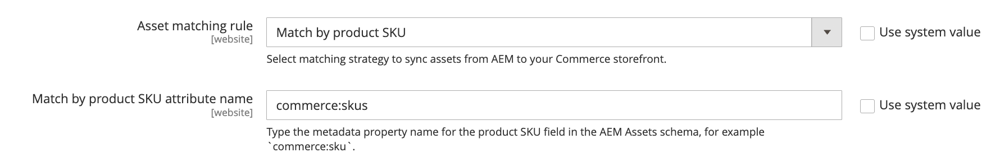

# 기본 자동 일치

Commerce용 AEM Assets 통합은 **AEM Assets** 메타데이터 구성을 기반으로 기본 자동 일치 메커니즘(**[!UICONTROL Match by product SKU]**)을 제공합니다. 이 규칙을 사용하면 **Adobe Commerce**&#x200B;과(와) **AEM Assets** 간의 원활한 동기화를 통해 자산이 자동으로 올바른 머천다이징 엔터티에 연결되도록 할 수 있습니다.

## 자동 일치 메커니즘 구성

1. Commerce 관리자에서 **[!UICONTROL Stores]** > **[!UICONTROL Settings]** > **[!UICONTROL Configuration]** > **[!UICONTROL ADOBE SERVICES]** > **[!UICONTROL AEM Assets Integration]**(으)로 이동합니다.

1. **[!UICONTROL Match by product SKU]**&#x200B;을(를) 일치 규칙으로 지정합니다.

   {width="700" zoomable="yes"}

1. **[!UICONTROL Match by product SKU attribute name]**&#x200B;에서 실제 SKU 값이 아닌 AEM Assets에 제품 SKU를 저장하는 [메타데이터 속성 이름](../metadata.md)을 입력합니다.

   >[!NOTE]
   >
   > 표준 온보딩 프로세스를 따랐다면 이 값을 `commerce:skus`(으)로 설정해야 합니다.

## 자동 일치 메커니즘 작동 방식

**[!UICONTROL Match by product SKU]** 일치 규칙이 Commerce 관리자에 구성된 경우 Commerce 자산 파일은 각 파일에 대해 구성된 자산 메타데이터를 기반으로 AEM Assets에서 Commerce 프로젝트로 자동으로 동기화됩니다. **AEM Assets 작성자** 환경의 AEM **Commerce** 탭에서 메타데이터를 구성합니다.

1. AEM Assets 작성자 인스턴스를 엽니다(URL은 Adobe Commerce과 동일한 IMS 조직의 프로젝트에 대해 프로비저닝됨).

1. 기본 탐색 화면에서 **Assets**&#x200B;를 클릭하여 DAM(디지털 자산 관리) 인터페이스에 액세스합니다.

1. AEM Assets에서 `Eligible for Commerce` 필드를 `Yes`(으)로 설정하여 이미지 메타데이터를 업데이트하여 Adobe Commerce 연결을 추가합니다.

   {width="600" zoomable="yes"}

1. 연결된 제품 SKU에 자산을 연결하는 메타데이터([!UICONTROL SKU], [!UICONTROL position] 및 [!UICONTROL role])를 구성합니다.

   4개의 표준 역할은 `image`, `small_image`, `thumbnail` 및 `swatch_image`입니다. AEM Assets 통합 확장 버전 1.4.6 이상에서는 `hero` 또는 `custom_role_1`과(와) 같은 사용자 지정 이미지 역할도 입력할 수 있습니다. 자세한 내용은 [사용자 지정 자동 일치](custom-match.md)를 참조하십시오.

   >[!NOTE]
   >
   > 자산이 여러 제품에 사용되는 경우 연결된 각 SKU에 대한 메타데이터를 구성합니다.

1. `Basic` 탭에서 _[!UICONTROL Review Status]_필드의 기본값을 `approved`(으)로 설정합니다.

   {width="600" zoomable="yes"}

에셋을 승인한 후 [제품 연결, 동기화 결과 및 상점 표시를 확인합니다](../get-started/setup-synchronization.md#verify-the-integration). 에셋이 나타나지 않으면 [동기화 상태](../get-started/sync-status.md)를 검토하십시오. Adobe Commerce Optimizer의 경우 대신 [Optimizer 확인 워크플로](../get-started/configure-aco.md#match-by-sku-workflow-example)를 사용하십시오. 동기화 상태는 사용할 수 없습니다.

[!BADGE PaaS만 해당]{type=Informative tooltip="Adobe Commerce on Cloud 프로젝트에만 적용됩니다(Adobe 관리 PaaS 인프라)."} 추가 동기화 문제 해결은 [통합 로그](../get-started/logs.md)를 검토하세요.
