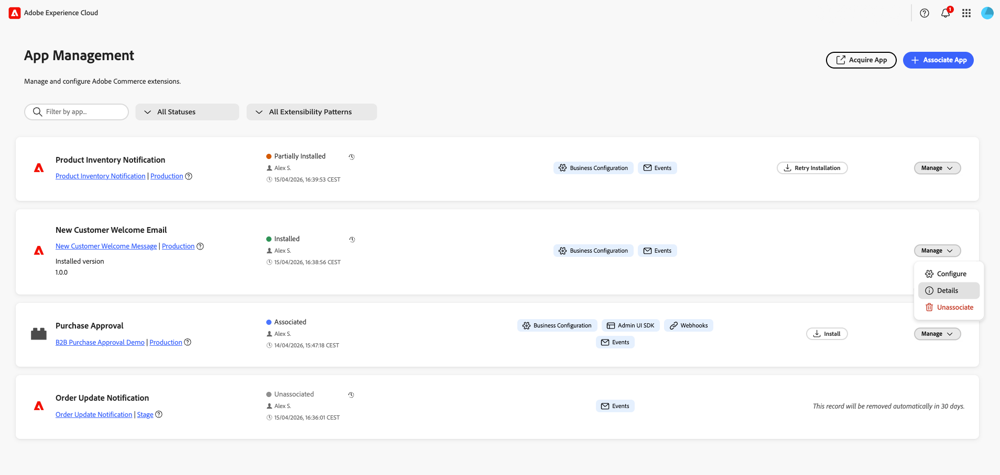
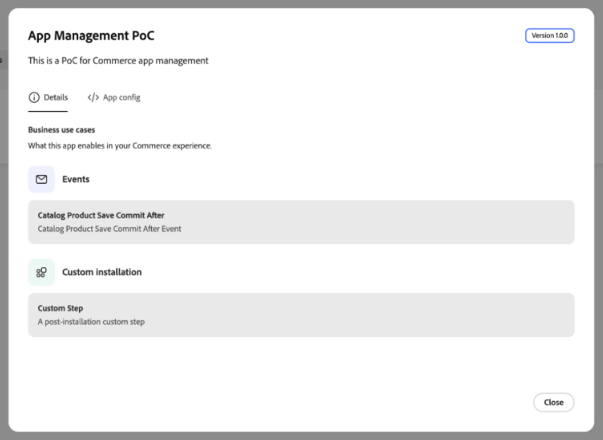
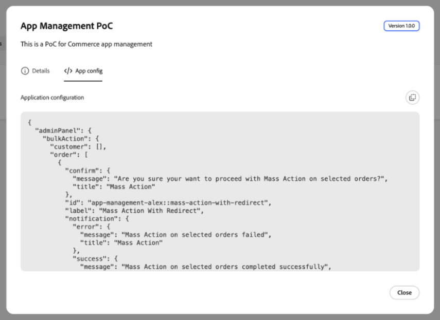
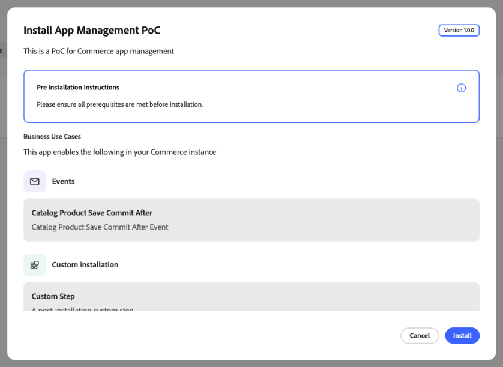
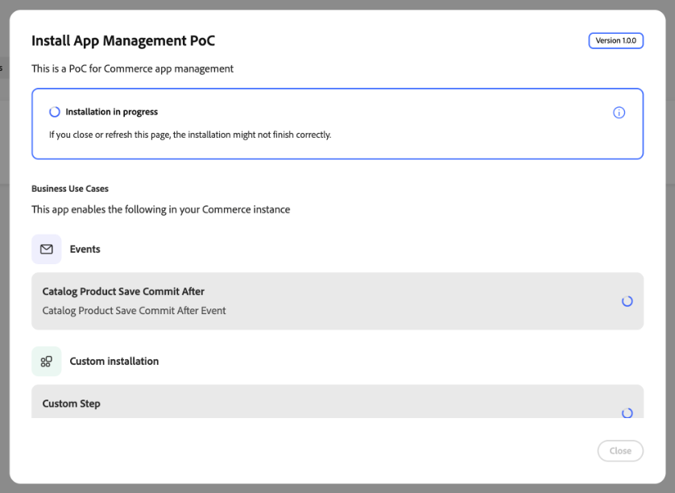
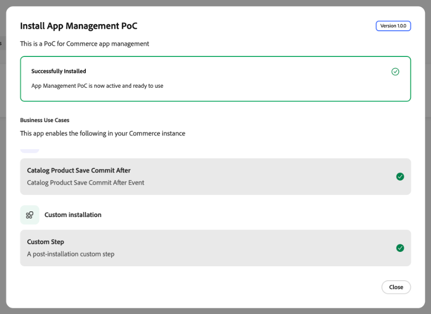
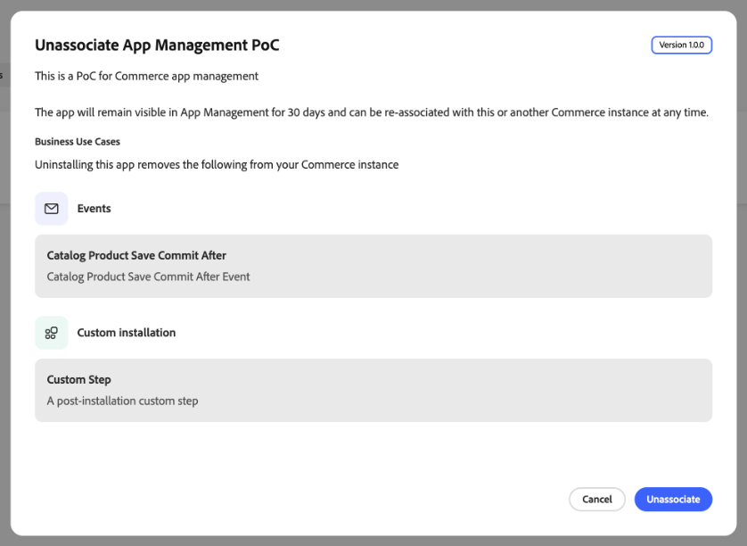

# 앱 관리

[!DNL App Management]을(를) 사용하여 App Builder 애플리케이션을 Commerce 인스턴스와 연결, 설치, 구성, 업그레이드 및 연결 해제할 수 있습니다. 구성 양식은 각 앱의 스키마에서 생성되므로 사용자 정의 관리 UI 개발 없이 설정을 관리할 수 있습니다.

{width="500" zoomable="yes"}

## 관리자에서 애플리케이션 찾기

**[!UICONTROL Apps]** > **[!UICONTROL App Management]**&#x200B;에서 각 응용 프로그램이 카드로 표시됩니다. 목록에는 선택한 Adobe IMS 조직의 Adobe Commerce 인스턴스와 연결된 모든 앱이 포함될 수 있습니다. 카드 위의 컨트롤을 사용하여 결과 범위를 좁힐 수 있습니다.

| 제어 | 설명 |
| --- | --- |
| **[!UICONTROL Filter by app...]** | 애플리케이션 이름별로 검색합니다. |
| **[!UICONTROL Status]** | 라이프사이클 상태별로 카드를 제한합니다. **[!UICONTROL All Statuses]**&#x200B;은(는) 모든 앱을 표시합니다. 다른 값은 **[!UICONTROL Associated]**, **[!UICONTROL Installed]**, **[!UICONTROL Partially Installed]** 및 **[!UICONTROL Unassociated]**&#x200B;입니다. 각 카드의 상태가 목록의 색상 표시기와 일치합니다. |
| **[!UICONTROL Extensibility patterns]** | 앱에서 사용하는 기능으로 카드를 제한합니다. **[!UICONTROL All Extensibility Patterns]**&#x200B;은(는) 모든 앱을 표시합니다. 다른 값은 **[!UICONTROL Business Configuration]**, **[!UICONTROL Admin UI SDK]**, **[!UICONTROL Webhooks]** 및 **[!UICONTROL Events]**&#x200B;과(와) 같이 각 카드의 배지와 일치합니다. |

검색 필드와 두 필터가 함께 적용됩니다. 전체 목록을 다시 표시하려면 검색 필드를 지우고 **[!UICONTROL All Statuses]** 및 **[!UICONTROL All Extensibility Patterns]**&#x200B;을(를) 선택하십시오.

### 애플리케이션 세부 정보 검토

응용 프로그램 카드에서 **[!UICONTROL Manage]** > **[!UICONTROL Details]**&#x200B;을(를) 선택하여 이름, 설명 및 버전을 검토합니다. 이 대화 상자에는 두 개의 탭이 있습니다.

* **[!UICONTROL Details]**&#x200B;은(는) 이벤트 및 사용자 지정 설치 단계를 포함한 응용 프로그램의 비즈니스 사용 사례를 나열합니다. 애플리케이션이 Commerce에 추가하는 사항을 이해하려면 레이블과 설명을 검토하십시오.
* **[!UICONTROL App config]**&#x200B;은(는) 검사를 위해 응용 프로그램의 구성을 JSON으로 표시합니다.

{width="600" zoomable="yes"}

{width="600" zoomable="yes"}

## 앱 획득

**[!UICONTROL Acquire App]**&#x200B;에서 [Adobe Exchange](https://exchange.adobe.com/apps/browse/ec){target="_blank"}에 대한 새 브라우저 탭(또는 별도의 브라우저 보기)을 엽니다. 이 탭에서 Commerce 관련 마켓플레이스 목록을 검색하고 Adobe IMS 조직에 응용 프로그램을 추가할 수 있습니다. 앱을 획득, 승인 및 배포하면 [연결](#associate-an-app) 및 [설치](#install-an-app)를 위해 [!DNL App Management]에 앱이 표시됩니다.

## 사전 요구 사항

앱을 연결하기 전에 다음을 확인하십시오.

| 요구 사항 | 설명 |
| --- | --- |
| **관리자 액세스** | [!DNL App Management] 권한이 있는 Commerce 관리자 |
| **배포된 앱** | 조직에 배포되고 연결할 준비가 된 App Builder 애플리케이션 |
| **조직 액세스** | 앱이 배포된 Adobe 조직에 대한 액세스 |

## 튜토리얼

이 비디오를 통해 앱을 Commerce 인스턴스와 연결하고 설정을 구성하는 방법에 대해 알아보십시오.

>[!VIDEO](https://video.tv.adobe.com/v/3478944)

## 앱 연결

연결 프로세스는 Commerce에서 웹 사이트, 스토어 및 스토어 보기를 가져오고 앱과 Commerce 인스턴스 간에 링크를 만듭니다.

App Builder 애플리케이션을 Commerce 인스턴스에 연결하려면 다음을 수행하십시오.

1. **[!UICONTROL Apps]** > **[!UICONTROL App Management]**(으)로 이동합니다.

1. **[!UICONTROL Associate App]**&#x200B;을(를) 클릭합니다.

   {width="500" zoomable="yes"}

1. 목록에서 **[!UICONTROL Project]**&#x200B;을(를) 선택하십시오.

1. **[!UICONTROL Workspace]** 선택.

1. **[!UICONTROL Associate]**&#x200B;을(를) 클릭합니다.

   {width="500" zoomable="yes"}

>[!WARNING]
>
>범위 동기화가 실패하면 연결이 계속 완료됩니다. 나중에 연결된 앱의 구성에 있는 **[!UICONTROL Manage Scopes]** 보기에서 범위를 수동으로 동기화할 수 있습니다.

## 앱 설치

연결은 앱을 Commerce 인스턴스에 연결합니다. 이벤트, 웹후크, 관리 UI 확장 프로그램 또는 사용자 지정 설치 단계와 같이 설치 가능한 구성 요소가 포함된 앱의 경우 설치 시 해당 구성 요소가 인스턴스에 적용됩니다.

1. [!DNL App Management]에서 연결된 앱의 설치 대화 상자를 엽니다.

1. 애플리케이션의 비즈니스 사용 사례 및 나열된 설치 단계를 검토합니다.

1. **[!UICONTROL Pre Installation Instructions]**&#x200B;이(가) 표시되면 계속하기 전에 해당 필수 구성 요소를 완료하십시오.

   {width="600" zoomable="yes"}

1. **[!UICONTROL Install]**&#x200B;을(를) 클릭합니다.

1. 설치가 완료될 때까지 개별 항목에 대한 진행 표시기를 모니터링합니다.

   {width="600" zoomable="yes"}

   >[!WARNING]
   >
   >설치가 완료될 때까지 페이지를 열어 두십시오. 페이지를 닫거나 새로 고치면 설치가 올바르게 완료되지 않을 수 있습니다.

1. **[!UICONTROL Successfully Installed]**&#x200B;이(가) 표시되고 완료된 항목에 확인 표시가 있는지 확인하십시오.

   {width="600" zoomable="yes"}

1. 앱에서 제공하는 설치 후 지침을 완료한 다음 필요에 따라 [설정을 구성](#configure-settings)합니다.

## 설정 구성

[!DNL App Management] 보기에서 앱을 연결한 후 다음 양식을 통해 설정을 구성하십시오.

1. 연결된 앱 카드에서 **[!UICONTROL Manage]** > **[!UICONTROL Configure]**&#x200B;을(를) 선택합니다.

앱의 구성 가능한 설정이 양식에 표시됩니다.

1. 필요에 따라 값을 수정합니다.

1. **[!UICONTROL Save]**&#x200B;을(를) 클릭합니다.

### 범위별 구성

서로 다른 웹 사이트, 스토어 또는 스토어 보기에 고유한 설정이 필요한 경우 범위별 구성을 사용하십시오. 예를 들어 특정 지역 또는 스토어 보기에 대해서만 기능을 활성화하거나 브랜드별로 다른 설정을 사용합니다. 낮은 범위의 설정은 높은 범위의 설정을 덮어씁니다.

특정 범위 레벨에서 글로벌 값을 재정의하려면

1. **[!UICONTROL Change Scope]**&#x200B;을(를) 클릭합니다.

1. 목록에서 범위를 선택합니다.

1. 이 범위의 값을 수정합니다.

1. **[!UICONTROL Save]**&#x200B;을(를) 클릭합니다.

## 범위 관리

앱 세부 정보 화면에서 **[!UICONTROL Manage Scopes]**&#x200B;에 액세스하여 앱의 범위 계층 구조를 관리합니다.

{width="500" zoomable="yes"}

| 액션 | 설명 |
| --- | --- |
| **[!UICONTROL Add root scope]** | 앱에만 적용되는 범위를 추가합니다. |
| **[!UICONTROL Sync Commerce scopes]** | 추가 또는 변경 후 Commerce에서 웹 사이트, 스토어 및 스토어 보기 목록을 새로 고칩니다. |
| **[!UICONTROL Import scopes]** | 파일에서 범위를 일괄적으로 가져옵니다. |

## 앱 업그레이드

앱 개발자가 설치된 앱의 새 버전을 배포하면 [!DNL App Management]에게 업그레이드를 사용할 수 있다는 알림이 표시됩니다. App Builder 배포 및 앱 관리 업그레이드는 별도의 작업입니다. 업그레이드는 이벤트, 웹후크 및 관리 UI 확장과 같은 설치된 구성 요소에 계획된 변경 사항을 적용합니다.

앱 개발자에게 앱이 업그레이드를 지원하는지 확인하십시오. SDK 사전 요구 사항 및 마이그레이션 요구 사항에 대해서는 개발자 설명서에서 [앱 업그레이드](https://developer.adobe.com/commerce/extensibility/app-management/upgrade-app/){target="_blank"}를 참조하십시오.

### 업그레이드 검토 및 시작

기본값인 수동 모드에서는 [!DNL App Management]에서 업그레이드를 검토하고 시작합니다.

1. 설치된 앱 버전 및 구성을 기록하고 앱 개발자의 도움을 받아 애플리케이션 데이터 및 외부 리소스를 백업합니다.

1. **[!UICONTROL Apps]** > **[!UICONTROL App Management]**(으)로 이동하여 앱에 사용 가능한 업그레이드를 엽니다.

1. 계획된 변경 사항 및 모든 경고를 검토합니다. 업그레이드는 구성 요소를 추가, 수정 또는 제거할 수 있습니다. 사용자 정의 설치 단계가 제거되면 제거 스크립트가 실행되지 않고 작성된 리소스는 자동으로 정리되지 않습니다. 계속하기 전에 앱 개발자와 함께 필요한 정리를 확인하십시오.

1. 업그레이드를 시작하고 나열된 작업의 진행 상황을 모니터링합니다.

1. 업그레이드 결과를 검토하고 실패한 작업이 있는지 확인합니다. 업그레이드가 실패하면 **[!UICONTROL Retry Upgrade]**&#x200B;을(를) 사용하기 전에 [업그레이드 실패](troubleshooting.md#upgrade-fails)를 따르십시오.

수동 모드에서는 업그레이드를 시작할 때까지 설치된 Commerce 구성 요소에 대한 계획된 변경 사항이 적용되지 않습니다. 그러나 배포는 업그레이드가 실행되기 전에 설치된 앱이 이미 사용하는 런타임 작업 코드를 업데이트할 수 있습니다.

### 자동 업그레이드

앱 개발자가 업그레이드 모드를 제어합니다. 개발자에게 앱에서 수동 또는 자동 업그레이드를 사용하는지 여부를 확인합니다.

>[!WARNING]
>
>자동 업그레이드는 외부 리소스를 수정할 수 있는 사용자 정의 설치 스크립트를 포함하여 관리자 검토 없이 배포 후 시작할 수 있습니다. 새로 배포된 버전이 수동에서 자동으로 모드를 변경하는 경우를 포함하여 자동 업그레이드가 활성화되기 전에 개발자와 협력합니다.

### 비즈니스 구성 변경 사항

앱의 비즈니스 구성 스키마 변경 사항은 배포 후 자동으로 표시됩니다. 설치 및 업그레이드와는 별개이며 앱 업그레이드를 트리거하지 않습니다.

## 앱 연결 해제

더 이상 Commerce 인스턴스에 연결할 필요가 없을 때 앱 연결을 해제합니다. 예를 들어 통합을 중단하거나, 다른 작업 공간으로 전환하거나, 테스트 구성을 정리해야 할 수 있습니다.

>[!WARNING]
>
>연결을 해제하면 이 인스턴스에 대한 모든 구성 값이 제거됩니다. 이 작업은 취소할 수 없습니다. 설치 제거는 사용자 지정 제거 스크립트를 통해 앱 구성 요소와 리소스를 제거할 수도 있습니다.

계속하기 전에 설치된 버전 및 구성을 기록하고 애플리케이션 데이터를 백업한 다음 앱 개발자에게 앱의 제거 스크립트가 제거되고 수동 정리가 필요한 리소스를 요청합니다. 서비스 중단에 대한 계획과 앱, 앱 설정 및 데이터를 복원하는 방법을 계획합니다. 정기 업데이트의 경우 연결을 해제하지 않고 [앱을 업그레이드](#upgrade-an-app)하세요.

Commerce 인스턴스에서 앱을 제거하려면 다음 작업을 수행하십시오.

1. **[!UICONTROL Apps]** > **[!UICONTROL App Management]**(으)로 이동합니다.

1. 앱 카드에서 **[!UICONTROL Manage]** > **[!UICONTROL Unassociate]**&#x200B;을(를) 선택합니다.

1. 이벤트 및 사용자 정의 설치 단계를 포함하여 나열된 비즈니스 사용 사례 및 제거 시 영향을 받는 구성 요소를 검토하십시오.

   {width="600" zoomable="yes"}

1. 작업을 확인합니다.

## 관련 설명서

* [문제 해결 [!DNL App Management]](troubleshooting.md) - 연결, 설치, 구성 및 업그레이드와 관련된 일반적인 문제를 해결합니다.
* [앱을 업그레이드하세요](https://developer.adobe.com/commerce/extensibility/app-management/upgrade-app/){target="_blank"} - 업그레이드 모드, 마이그레이션 스크립트 및 진단에 대한 개발자 요구 사항입니다.
