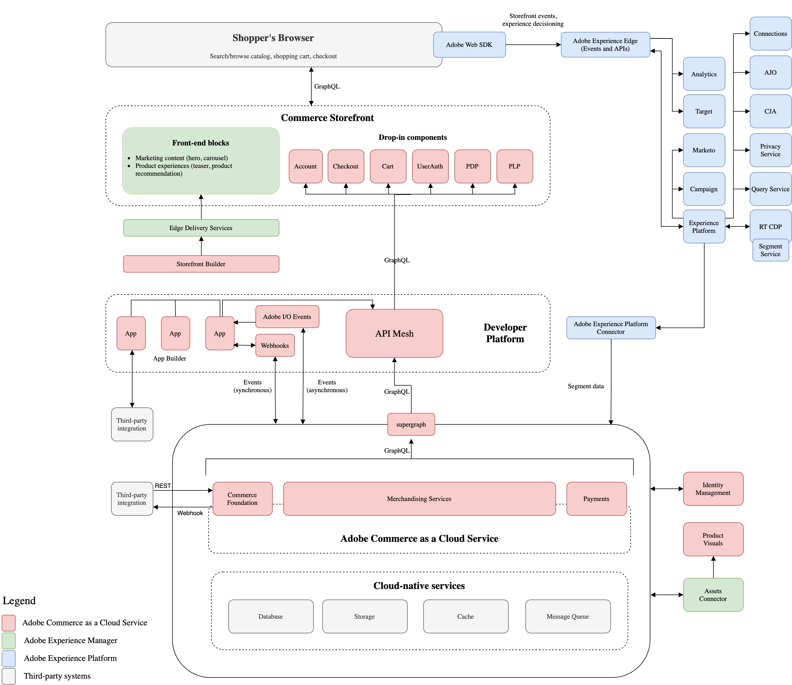

# 구성 가능한 카탈로그 데이터 모델을 사용한 머천다이징 서비스

Adobe Commerce as a Cloud Service은 이제 머천다이징 서비스를 통해 CCDM(Composable Catalog Data Model)을 지원합니다. Adobe Commerce Optimizer은 이 데이터 모델을 도입했으며 CCDM은 두 제품 모두에 상점 카탈로그 탐색 및 머천다이징 기능을 제공하는 공통 기반을 제공하는 한편 Commerce Foundation은 제품, 가격 및 트랜잭션을 계속 관리합니다.

이 항목에서는 CCDM의 변경 사항, 기능 지속 및 변경 사항이 판매자, 파트너 및 상점 개발자에게 무엇을 의미하는지 설명합니다.

## CCDM에는 어떤 변경 사항이 도입됩니까?

원본 카탈로그 모델은 [카탈로그 서비스](https://experienceleague.adobe.com/en/docs/commerce/catalog-service/overview)를 사용하여 제품 데이터를 상점 앞으로 전달하고, 검색, 머천다이징 및 추천 기능을 제공하는 라이브 검색 및 제품 추천 기능을 제공합니다. 이 모델에서 Commerce은 [SaaS 데이터 내보내기](https://experienceleague.adobe.com/en/docs/commerce/saas-data-export/overview)를 사용하여 데이터를 서비스 레이어에 동기화합니다.

CCDM을 사용하면 이러한 기능이 Adobe Commerce Optimizer을 지원하는 것과 동일한 카탈로그 기반에서 작동합니다. [카탈로그 보기](https://experienceleague.adobe.com/en/docs/commerce-admin/merchandising-with-ccdm/setup/catalog-view) 및 [정책](https://experienceleague.adobe.com/en/docs/commerce-admin/merchandising-with-ccdm/setup/policies)은(는) 상점 앞에서 사용할 수 있는 카탈로그 컨텍스트를 정의합니다. 정책은 제품 분류를 결정하고, 머천다이징 규칙은 모든 카탈로그 보기에 적용되거나 특정 보기에 맞게 조정될 수 있습니다.

이렇게 하면 카탈로그의 구성, 액세스 및 머천다이징 방법이 변경됩니다. CCDM은 카탈로그 보기 수준에서 제어를 도입하는 동안 원래 Commerce 카탈로그의 검색, 권장 사항 및 머천다이징 기능을 빌드합니다. 추가 관리 및 보고 기능은 아래에 설명되어 있습니다.

Commerce 재단은 제품과 가격의 표준 소스로 남아 있습니다. 제품 및 가격 데이터는 기본 Adobe Commerce as a Cloud Service 통합을 통해 CCDM에 대한 한 가지 방법을 동기화합니다. 웹 사이트, 스토어 및 스토어 뷰 구성은 기존 장바구니, 체크아웃 및 주문 관리 워크플로우와 함께 Commerce에 유지됩니다.

## 라이센스 및 프로비저닝

CCDM이 포함된 머천다이징 서비스는 기존 Adobe Commerce as a Cloud Service SKU에 포함됩니다. 두 번째 제품 또는 구독이 아니며 별도의 Adobe Commerce Optimizer 구매, 권한 또는 테넌트가 필요하지 않습니다.

## 아키텍처 개요

[!DNL Commerce Foundation]은(는) 제품 및 가격에 대한 기본 레코드로 유지되며 트랜잭션을 계속 관리합니다. 기본 통합은 [!DNL Commerce]에서 CCDM으로 제품 및 가격 데이터를 한 방향으로 동기화합니다. 이 동기화를 위해 별도의 커넥터 또는 [!DNL App Builder] 앱을 설치하지 않습니다.

Storefront는 CCDM 지원 머천다이징 서비스를 사용하여 찾아보기, 검색, 권장 사항 및 머천다이징을 위한 카탈로그 데이터와 컨텍스트를 검색합니다. 요청은 카탈로그 컨텍스트를 사용하여 의도한 대상에 대한 제품 및 가격을 검색합니다. [!DNL Commerce]에서 웹 사이트, 스토어 및 스토어 보기 구성을 계속 관리합니다.

다음 다이어그램은 더 광범위한 Adobe Commerce as a Cloud Service 아키텍처에서 CCDM을 사용하는 머천다이징 서비스의 위치를 보여 줍니다.

{zoomable="yes"}

## 상인들을 위한 새로운 것은 무엇인가?

새 모델을 사용하면 기존 머천다이징 규칙의 범위를 모든 카탈로그 보기 또는 특정 보기로 지정할 수 있습니다. 이렇게 하면 각 상점 대상 그룹에 머천다이징을 적용할 수 있습니다. 카탈로그 보기에 머천다이징 규칙을 [범위 지정](https://experienceleague.adobe.com/en/docs/commerce-admin/merchandising-with-ccdm/merchandising/rules/add)하는 방법에 대해 알아봅니다.

관리에서 [!UICONTROL Catalog Views] 및 [!UICONTROL Policies]&#x200B;(으)로 카탈로그 컨텍스트를 구성할 수 있습니다. [!UICONTROL Success Metrics]을(를) 사용하여 매출, 전환, 참여, 획득 및 바운스 비율을 검토할 수도 있습니다. 자세한 내용은 [성공 지표](https://experienceleague.adobe.com/en/docs/commerce-admin/merchandising-with-ccdm/manage-results/success-metrics)를 참조하십시오.

## 채택 전 고려 사항

CCDM을 사용한 머천다이징 서비스를 채택하기 전에 CCDM 모델이 라이선스, 카탈로그 통합, 상점 및 관리 워크플로우에 미치는 영향을 검토하십시오.

### 카탈로그 관리 및 통합

[!DNL Commerce Foundation]에서 제품 및 가격을 계속 관리합니다. 기본 통합은 CCDM에 동기화합니다. 머천다이징 서비스에 대한 두 번째 제품 카탈로그를 만들지 마십시오.

### Storefront 구현

Storefront에서 카탈로그 데이터를 검색하는 방법은 구현에 따라 다릅니다.

- **[!DNL Adobe Commerce Storefront]** 드롭인 - 드롭인이 전환을 처리합니다. 코드를 변경할 필요가 없습니다. [상점 설치 설명서](https://experienceleague.adobe.com/en/tools/commerce-storefront/)를 참조하세요.
- **사용자 지정 또는 기타 상점**—[헤더 구성 참조](https://experienceleague.adobe.com/en/tools/commerce-storefront/setup/configuration/commerce-configuration/#headers)에 설명된 대로 카탈로그 요청 헤더를 업데이트합니다.

CCDM 기반 모델에 대한 카탈로그 쿼리 및 요청 헤더를 검토합니다. 기존 쿼리나 헤더가 변경되지 않았다고 가정하지 마십시오. 머천다이징 GraphQL 쿼리는 원래 카탈로그 서비스 모델에 사용된 쿼리와 다릅니다. 추가 쿼리는 CCDM을 지원합니다. [머천다이징 GraphQL API 참조](https://developer.adobe.com/commerce/services/reference/graphql/)를 사용하고 [storefront 헤더 참조](https://experienceleague.adobe.com/en/tools/commerce-storefront/setup/configuration/commerce-configuration/#headers)에 대해 필요한 카탈로그 컨텍스트를 확인하십시오.

### 타사 앱 및 확장

카탈로그 데이터를 읽거나 공급자와 함께 카탈로그 이벤트를 사용하는 타사 앱 및 확장을 검토하십시오. 호환성은 각 앱 또는 확장에서 이러한 인터페이스를 사용하는 방법에 따라 다릅니다.

### 머천다이징 API

머천다이징 서비스는 백엔드 카탈로그 데이터 관리 및 상점 카탈로그 검색을 위한 API를 제공합니다. REST API를 사용하여 카탈로그 데이터를 관리하고 GraphQL API를 사용하여 상점 경험을 위한 데이터를 검색합니다.

- **REST API:** [데이터 수집 API 시작](https://developer.adobe.com/commerce/services/optimizer/data-ingestion/using-the-api)에 따라 백 엔드 애플리케이션에서 제품 및 카탈로그 데이터를 만들고 관리합니다.
- **GraphQL API:** [머천다이징 API 시작](https://developer.adobe.com/commerce/services/optimizer/merchandising-services/using-the-api)에 따라 상점 경험을 위한 카탈로그 데이터를 검색합니다. [storefront 헤더 참조](https://experienceleague.adobe.com/en/tools/commerce-storefront/setup/configuration/commerce-configuration/#headers)에 설명된 대로 storefront에 필요한 헤더로 요청을 구성합니다.

### 관리자 경험

CCDM이 포함된 Adobe Commerce as a Cloud Service은 [[!DNL Adobe Unified Experience]](https://experienceleague.adobe.com/en/docs/commerce-admin/start/admin/admin-unified-experience)&#x200B;(통합 쉘)을 사용합니다. Adobe은 통합 쉘을 CCDM과 별도로 출시했습니다. 원본 카탈로그 서비스 모델의 기존 인스턴스는 Classic 및 Unified Shell에 대한 액세스 권한을 유지합니다.

### 제한

CCDM 모델은 Adobe Commerce as a Cloud Service 제한을 변경하지 않습니다. Optimizer와 카탈로그 기반을 공유한다고 해서 Commerce이 Optimizer 용량 또는 제한을 상속받는 것은 아닙니다.

## 가용성 및 마이그레이션

2026년 11월 18일 릴리스 이후 Adobe Commerce as a Cloud Service으로 시작하는 조직에는 기본적으로 CCDM이 포함된 머천다이징 서비스가 포함됩니다. 조직에서 원본 카탈로그 데이터 모델을 필요로 하는 경우, Adobe 계정 팀에 문의하여 예외를 사용할 수 있는지 여부를 논의하십시오.

이 릴리스 이전에 Adobe Commerce as a Cloud Service이 있었던 조직은 [새 인스턴스를 프로비전할 때](./getting-started.md#create-an-instance) 카탈로그 모델을 선택할 수 있습니다. 기본적으로 [!UICONTROL Enable CCDM] 전환기는 비활성화되어 있습니다. CCDM이 활성화되면 비활성화할 수 없습니다.

기존 인스턴스는 자동으로 변경되지 않습니다. GA(일반 배포)에서는 기존의 원래 카탈로그 서비스 인스턴스를 머천다이징 서비스로 마이그레이션할 수 없습니다.

>[!MORELIKETHIS]
>
>* [CCDM Commerce 관리 가이드를 사용한 머천다이징 서비스](https://experienceleague.adobe.com/en/docs/commerce-admin/merchandising-with-ccdm/overview)
