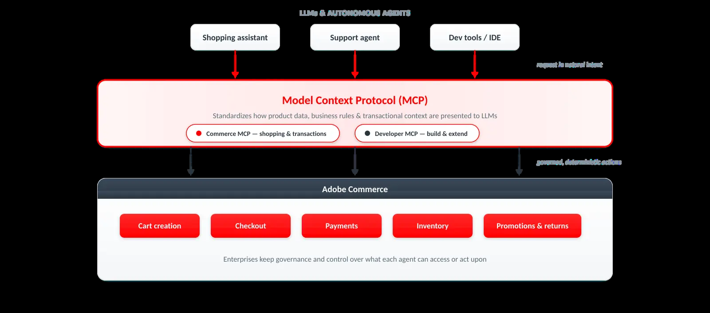

# 쇼핑객 및 AI 에이전트를 위한 상거래 플랫폼 설계

<table style="table-layout:auto">
<tr style="border: 0;">
   <td valign="middle" style="vertical-align: middle;"> <strong>Surya Lamech</strong> <em>기본 제품 마케팅 관리자</em></td>
</tr>
</table>

*인간과 AI 에이전트가 하나의 진실 소스와 상호 작용하는 상거래 플랫폼 디자인*

Commerce은 구조적인 변화를 겪고 있다. 고객은 더 이상 검색 엔진이나 상점 앞을 탐색하는 것에만 의존하지 않습니다. 대신 LLM 기반 인터페이스, 채팅 기반 도우미 및 아젠틱 쇼핑 도구를 사용하여 질문을 하고, 소매업체 간 제품을 비교하고, 초기 단계 의사 결정을 가속화합니다.

이러한 인터페이스는 검색, 교육 및 비교를 위한 강력한 엔진입니다. 고객은 기존 탐색보다 더 빠르게 요구 사항을 명확히 하고, 상충점을 평가하며, 선택의 폭을 좁힐 수 있습니다.

그러나 구매를 완료해야 하는 시점에 이르면 고객은 여전히 결제 보안, 이행 투명성, 구매 후 서비스를 잘 이해하는 신뢰할 수 있는 상점 및 브랜드 소유 사이트를 압도적으로 선호합니다. 전환은 이미 신뢰가 확립된 환경에서 정박되어 있다.

중요한 것은 이 단계에서 AI가 사라지는 것은 아니라는 점이다. 고객이 브랜드 소유의 매장에 도착하면, 아젠틱 AI는 제품 선택을 안내하고, 추천을 실시간으로 개인화하고, 이의사항에 답변하고, 보완적인 항목을 묶어주고, 체크아웃 절차를 간소화함으로써 경험을 강화할 수 있다. 이러한 신뢰받는 환경에서 AI는 전환 가속기가 되어 완료율이 향상되고 평균 주문 가격이 높아집니다.

이 새로운 환경에서 경쟁하려면 기업은 **인적 자원과 에이전트 소비를 위해 구조화되고 관리되고 최적화된 상거래 기반이 필요합니다**. Adobe Commerce은 이러한 변화를 위해 구축되었으며, 아래의 원칙은 진정한 에이전트 준비가 되는 데 필요한 사항에 대해 간략히 설명합니다.

## 두 대상을 위해 빌드된 상거래 아키텍처

{width="800" zoomable="yes"}

*고객이 보는 내용과 소비하는 에이전트가 일관되고 정확하며 브랜드에 맞게 유지됩니다.*

이제 최신 상거래 스택은 사람과 AI 에이전트라는 두 개의 동일하게 중요한 대상을 제공해야 합니다. 상점 및 앱과 같은 사람이 대면하는 경험은 참여, 브랜드 표현 및 고객 충성도 구축에 필수적인 요소로 유지됩니다. 그러나 이와 함께 LLM 및 자율 에이전트에게 구조화된 사실, 관리되는 콘텐츠 및 트랜잭션 기능을 제공하는 기계 판독 가능한 엔드포인트와 같이 빠르게 확장되는 에이전트 관련 영역도 있습니다.

에이전트는 JavaScript을 해석하거나 프레젠테이션 레이어에서 비즈니스 규칙을 유추하는 대신 예측 가능한 API를 통해 제공되는 깔끔하고 구조화된 데이터로 작업할 때 가장 뛰어난 성능을 발휘합니다. 즉, 제품 사양, 가격, 가용성 및 프로모션 로직은 API 및 MCP 서버와 같은 표준화된 인터페이스를 통해 노출된 주소 지정 가능한 리소스로 존재해야 합니다. 인간과 에이전트를 대면하는 표면이 모두 동일한 진실의 근원에서 그려지는 경우 브랜드는 고객이 보는 것과 에이전트가 소비하는 것이 일관되고 정확하며 브랜드에 맞게 유지되도록 합니다.

이 이중 표면 아키텍처는 아젠틱 커머스의 기반입니다.

## 기계 추론을 위해 설계된 카탈로그

{width="800" zoomable="yes"}

*제품 데이터를 포크하지 않고 채널별로 구성된 신뢰할 수 있는 원본 중 하나.*

카탈로그는 아젠틱 커머스의 핵심이다. 시스템에 맞게 구성되고, 규정 준수에 맞게 관리되어야 하며, 인간과 에이전트의 상호 작용을 완벽하게 지원할 수 있을 만큼 유연해야 합니다. 카탈로그 보기, 정책, 레이어 및 구조화된 제품 엔터티를 중심으로 구축된 Adobe Commerce의 카탈로그 모델은 이러한 미래를 위해 설계되었습니다.

카탈로그 보기는 상점, 시장, 파트너 피드 또는 AI 표면에 제품 데이터가 노출되는 위치와 방법을 정의합니다. 각 보기는 고유한 제품 가용성, 가격 및 속성 가시성 규칙을 적용할 수 있으므로 올바른 정보가 올바른 소비자 또는 에이전트에게 전달되도록 합니다. 카탈로그 레이어를 사용하면 소스 제품 데이터를 수정하지 않고도 특정 채널에 대한 제품 데이터를 보강할 수 있습니다. 정책은 고객 자격, 재고 논리, 가격 및 규정 준수 제약 조건을 관리합니다. 결합된 기업은 에이전트가 액세스하거나 조치를 취할 수 있는 카탈로그 데이터를 정확하게 제어할 수 있습니다.

## 에이전트의 일반적인 언어로서의 MCP

{width="800" zoomable="yes"}

*MCP는 에이전트가 자연스러운 의도로 작업을 요청하고 Adobe Commerce이 이를 통제되고 결정론적인 작업으로 수행하는 방법을 표준화합니다.*

Agentic Commerce이 전체 기능을 수행하도록 하려면 전자 상거래 플랫폼은 에이전트가 장바구니 만들기, 체크아웃 시작, 결제 오케스트레이션, 인벤토리 유효성 검사, 프로모션 및 반품과 같은 작업을 안전하게 실행할 수 있도록 표준화된 프로토콜을 지원해야 합니다.

Adobe은 MCP(Model Context Protocol)에 대한 기본 지원을 통해 LLM이 일관되게 해석할 수 있는 방식으로 상거래 기능을 구조화하고 노출합니다. MCP는 제품 데이터, 비즈니스 규칙 및 트랜잭션 컨텍스트가 LLM에 표시되는 방식을 표준화하므로 에이전트가 이를 안정적으로 추론하고 기업이 거버넌스와 통제를 유지할 수 있습니다. Commerce MCP를 통해 기업은 쇼핑 도우미, 에이전트 장바구니 만들기, 지원 에이전트 등과 같은 사용자 정의 에이전트 경험을 구축할 수 있습니다.

개발자 MCP는 팀이 플랫폼 기능을 빠르게 확장하고 구성 가능한 상점 구성 요소를 배포할 수 있도록 AI 기반의 개발 기능을 제공합니다. 개발자 MCP는 Adobe의 지식 소스, 설명서 및 플랫폼 모범 사례를 개발 워크플로에 직접 포함시킴으로써 신규 개발자가 더 빠르게 온보딩하고 첫 스프린트에서 생산적이 되도록 지원합니다. 검증된 아키텍처 패턴을 따르고 유지 관리가 쉬우며 엔터프라이즈 커머스가 요구하는 품질 표준을 충족하는 코드를 생성합니다. 그 결과, 아이디어부터 생산까지 가속화된 경로를 통해 기업은 경쟁사보다 앞서 상거래 기능을 실험, 반복 및 운송할 수 있는 속도를 확보할 수 있습니다.

Adobe은 또한 ACP(Agentic Commerce Protocol) 및 UCP(Universal Commerce Protocol)와 같은 에이전시 상거래 프로토콜을 지원하기 위해 노력하고 있으며, 이를 통해 에이전트와 상점 간의 제품 검색 및 보안 표준 기반 트랜잭션 상호 작용을 수행할 수 있습니다.

Adobe은 포인트 통합이 아닌 개방형 프로토콜을 채택하여 상거래 상호 작용이 관리되고 결정적이며 안전하도록 하는 동시에 신뢰할 수 있는 에이전트가 명확하게 정의된 정책에 따라 직접 거래할 수 있는 새로운 에이전트-판매자 참여 모델을 활성화합니다.

## 원격 분석 및 지속적인 최적화

AI가 매개하는 생태계에서는 원격 측정이 전략적 이점이 된다. 기업은 LLM에서 브랜드가 어떻게 표시되는지, 에이전트가 콘텐츠를 얼마나 정확하게 표시하는지, 에이전트 참조 트래픽이 어떻게 전환되는지, 거버넌스 또는 규정 준수 문제가 발생하는 위치에 대한 가시성이 필요합니다. 또한 에이전트 실행을 추적하는 운영 원격 분석과 에이전트 상호 작용에 대한 예외 항목 탐지도 필요합니다.

Adobe을 통해 제품이 LLM에 표시되는 방식을 파악할 수 있고 AI로 제품 데이터를 향상시키며 LLMS를 통해 데이터 가독성을 높일 수 있습니다. 카탈로그에 의미 있는 컨텍스트를 추가하면 LLM은 제품을 정확하게 발견하는 것은 물론 제품이 무엇인지, 어떤 용도인지, 고객에게 중요한 이유를 파악할 수 있습니다.

또한 사람이 사용하도록 최적화된 제품 세부 사항 페이지에는 에이전트에 보이지 않는 데이터가 있을 수 있습니다. 이 데이터는 양식, 구성 요소 및 연결된 페이지 뒤에 숨길 수 있습니다. 상담원은 제품 카테고리, 번들 및 변형을 완전히 이해하지 못할 수 있습니다. Adobe은 이렇게 중요한 누락 정보를 식별하고 에이전트가 모든 관련 제품 데이터를 가져올 수 있도록 JSON-LD로 Edge에 배포할 수 있습니다.

이러한 끊임없는 원격 분석 및 최적화 브랜드를 통해 가시성을 극대화하고 LLM 전반에서 경쟁력을 유지할 수 있습니다.

## 이것이 중요한 이유

Ecommerce는 더 이상 상점 및 검색 결과에 제한되지 않습니다. LLM과 자율 에이전트들은 발견, 평가, 거래를 점점 더 매개한다. 이러한 변화는 가시성의 역학, 통제의 역학, 신뢰의 기초를 변화시킨다. Win이 설계하는 브랜드는 AI 기반 기반을 위한 것입니다.

## 관련 지침

* [카탈로그 보기](/help/optimizer/setup/catalog-view.md)
* [카탈로그 레이어](/help/optimizer/setup/catalog-layer.md)
* [정책](/help/optimizer/setup/policies.md)
* [Adobe Commerce App Builder용 AI 코딩 개발자 도구](/help/cloud-service/migration/coding-tools.md)
* [COMMERCE API](../../apis/commerce-apis.md)
* [Commerce 개발자 에이전트 재생 목록](https://experienceleague.adobe.com/en/playlists/commerce-developer-agent) - Commerce 개발자 에이전트 설정 및 사용에 대한 기술 비디오를 시청합니다.
