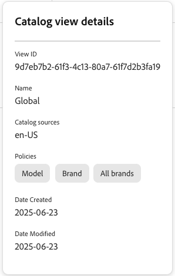

# 머천다이징 서비스에 대한 카탈로그 보기

{{$include /help/_includes/ccdm-shared/setup/catalog-view.md}}

## 카탈로그 보기 관리

다음 지침에 따라 카탈로그 보기를 관리합니다.

- [카탈로그 보기 만들기](#create-a-catalog-view) - 이름, 카탈로그 원본, 정책 및 가격표를 설정합니다. [권장 사항 및 제품 검색 규칙에 대한 카탈로그 보기를 지정](#specify-catalog-views-for-recommendations-and-product-discovery-rules), 제품 특성을 재정의하는 [카탈로그 계층](#catalog-layers)을 검토 또는 [카탈로그 보기를 비공개로 설정](#make-a-catalog-view-private)합니다.
- [카탈로그 보기 편집](#edit-a-catalog-view)—소스, 정책, 가격 장부 및 보호 설정을 업데이트합니다.
- [카탈로그 보기 삭제](#delete-a-catalog-view)—더 이상 필요하지 않은 카탈로그 보기를 제거합니다.
- [카탈로그 보기 세부 정보 보기](#view-catalog-view-details) - 카탈로그 보기 테이블에서 카탈로그 보기의 구성을 검토합니다.

### 카탈로그 보기 만들기

카탈로그 보기를 만들기 전에 필요에 따라 다음 항목을 준비합니다.

- [카탈로그 원본](catalog-sources.md)
- 제품 필터를 정의하는 [정책](policies.md)
- 제품 특성을 재정의해야 하는 경우 [카탈로그 계층](catalog-layer.md)
- 보기에 표시된 가격 책정에 대한 [가격 책자](pricebooks.md)
- 비공개 카탈로그 보기를 만들려면 [제한된 액세스 키](restricted-access-keys.md)

#### 구성

이 섹션에서 카탈로그 보기를 만들고 [정책](policies.md) 및 [가격 장부](pricebooks.md)를 선택합니다.

1. 왼쪽 메뉴에서 **[!UICONTROL Store setup]**(으)로 이동한 다음 **[!UICONTROL Catalog views]**&#x200B;을(를) 클릭합니다.

1. **[!UICONTROL Create catalog view]**&#x200B;을(를) 클릭합니다. &#x200B;

1. 카탈로그 보기 세부 사항을 구성합니다.

   - **이름**—카탈로그 보기의 이름을 입력하십시오(예: `Celport`). &#x200B;
   - **카탈로그 원본** - [카탈로그 원본](catalog-sources.md)을(를) 선택합니다(예: `en-US`).
   - **카탈로그 레이어** - 수집된 레이어 및 우선 순위를 검토합니다.
   - **정책**—드롭다운을 사용하여 관련 정책을 선택합니다. 예를 들어 &quot;Brand&quot;, &quot;Model&quot;입니다. 이미 [정책을 만들었는지](policies.md)&#x200B;확인하십시오.

1. 가격 장부를 선택하여 카탈로그 뷰에 연결합니다.

   - **사용 가능한 모든 가격 장부를 사용**—이 옵션은 사용 가능한 모든 가격 장부에서 가격 데이터를 가져옵니다.
   - **선택한 가격책만 허용**—이 옵션은 **허용된 가격책 추가** 대화 상자를 표시합니다. 이 대화상자를 사용하여 카탈로그 뷰에 사용할 특정 가격 장부를 선택합니다.
   - **단일 가격 장부만**—하나의 가격 장부만 적용되는 경우 이 옵션을 선택합니다. 이 옵션은 하나의 가격 장부만 참조할 수 있는 비공개 카탈로그 뷰를 구성하려는 경우 필요합니다. [개인 카탈로그 보기에 대한 가격 책자 제한](private-catalog-view.md#price-book-restriction-on-private-catalog-views)을 참조하세요.
   - **가격 책정 사용 안 함**—지금은 이 옵션을 사용할 수 없습니다.

   >[!NOTE]
   >
   >가격 장부 ID는 요청한 가격을 제어합니다. 카탈로그 보기에 대한 액세스를 제한하지 않습니다. 액세스를 제한하려면 [카탈로그 보호]를 사용하여 [개인 카탈로그 보기](private-catalog-view.md)를 만드세요.

1. (선택 사항) 이 카탈로그 보기의 데이터를 서명된 토큰이 유효한 클라이언트로 제한하려면 **[!UICONTROL Catalog Protection]**&#x200B;을(를) **[!UICONTROL Enabled]**(으)로 전환합니다. 설치 단계는 [카탈로그 보기 보호](private-catalog-view.md#protect-a-catalog-view)를 참조하십시오.

1. **[!UICONTROL Add]**&#x200B;을(를) 클릭하여 연결된 가격표 및 정책으로 카탈로그 보기를 만듭니다.

카탈로그 보기 페이지가 업데이트되어 새 카탈로그 보기가 표시됩니다&#x200B;.

이러한 단계를 완료하면 이제 선택한 소스 및 정책을 기반으로 제품 및 가격을 표시하도록 카탈로그 보기가 구성됩니다.

#### 권장 사항 및 제품 검색 규칙에 대한 카탈로그 보기 지정

[추천 단위를 만들기](../merchandising/recommendations/create.md) 또는 [머천다이징 규칙](../merchandising/rules/add.md)할 때 카탈로그 보기를 지정할 수 있습니다.

#### 카탈로그 레이어

카탈로그 계층을 사용하면 소스 카탈로그 데이터를 변경하지 않고 선택한 제품 속성을 재정의할 수 있습니다. 레이어를 사용하여 카탈로그 뷰의 이름, 설명, 이미지, 링크 또는 메타데이터를 사용자 지정합니다.

[카탈로그 계층](catalog-layer.md)을 참조하세요.

#### 카탈로그 보기를 비공개로 만들기

기본적으로 카탈로그 보기는 GraphQL 머천다이징 API에 액세스할 수 있는 클라이언트 애플리케이션에 공개됩니다. 액세스를 제한하려면 **[!UICONTROL Catalog Protection]**&#x200B;을(를) 활성화하여 비공개 카탈로그 보기를 구성하십시오.

카탈로그 보기를 보호하고 액세스가 적용되었는지 확인하는 방법은 [개인 카탈로그 보기](private-catalog-view.md)를 참조하세요.

### 카탈로그 보기 편집

1. **[!UICONTROL Catalog views]** 작업 영역에서 카탈로그 보기를 찾습니다.
1. 작업 메뉴를 열려면 (**[!UICONTROL ...]**)을(를) 선택합니다.
1. 카탈로그 보기 편집기에 액세스하려면 **[!UICONTROL Edit]**&#x200B;을(를) 선택하십시오.
1. 필요에 따라 이름, 카탈로그 원본, 정책, 가격 장부 정보 및 **[!UICONTROL Catalog Protection]** 설정(할당된 제한된 액세스 키 포함)을 업데이트합니다.
1. **[!UICONTROL Save]**&#x200B;을(를) 클릭합니다.

### 카탈로그 보기 삭제

1. **[!UICONTROL Catalog views]** 작업 영역에서 카탈로그 보기를 찾습니다.
1. 작업 메뉴를 열려면 (**[!UICONTROL ...]**)을(를) 선택합니다.
1. **[!UICONTROL Delete]**&#x200B;을(를) 선택합니다.
1. 삭제를 확인합니다.

   확인 대화 상자가 나타나면 **[!UICONTROL Delete]**&#x200B;을(를) 클릭합니다.

### 카탈로그 보기 세부 정보

이 옵션을 사용하면 **[!UICONTROL Catalog views]** 테이블에 있는 동안 모든 카탈로그 보기 매개 변수를 빠르게 볼 수 있습니다.

**[!UICONTROL Catalog views]** 작업 영역에서 카탈로그 보기에 대한 을(를) 선택하여 구성 세부 정보를 봅니다.

여기에서 카탈로그 보기 구성 세부 사항(예:

- ID 보기
- 이름
- 카탈로그 소스
- 정책
- 만든 날짜
- 데이터 수정됨

Storefront를 설정하거나 데이터 수집 API를 사용할 때 이러한 구성 설정 중 일부가 필요합니다.
