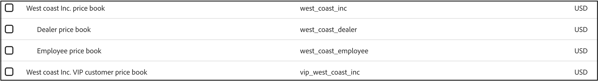
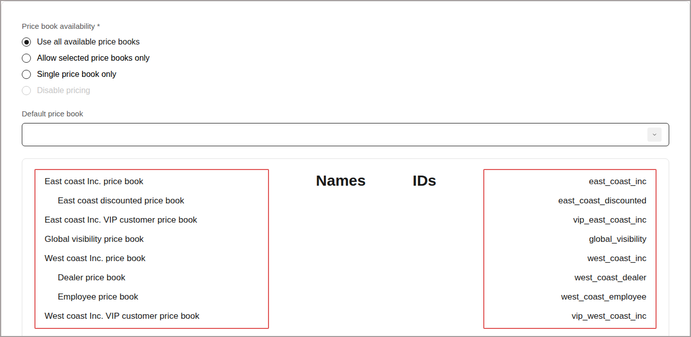

# 가격 장부

Price Book은 고객 계층 및 시장에서 카탈로그 소스의 제품 가격을 정의합니다. 계층 모델을 지원하므로 각 기준 가격 책 아래에 최대 3단계의 중첩된 하위 가격 책을 사용할 수 있습니다. 각 가격 장부는 상위 가격 장부를 참조할 수 있으며 가격 카탈로그 출처에 대한 트리 구조를 형성합니다.

기본 가격 장부는 자체 통화 및 모든 하위 가격 장부를 정의합니다. 하위 가격 장부는 이 통화를 상속하며 재정의할 수 없습니다.

## 주요 개념

| 용어 | 설명 |
| ------ | ------------- |
| **가격표** | 카탈로그 소스의 가격(예: 특정 지역 또는 고객 계층)을 정의하고 제품 가격을 관리하는 데 사용되는 논리적 그룹입니다. |
| **가격표 대체** | 계층 구조에서 가장 가격이 높은 책입니다. 여기에는 상위 항목이 없으며 자신과 모든 하위 항목의 가격 장부를 정의하는 *only* 가격 장부입니다.  가격 장부를 만드는 동안 부모가 정의되지 않은 경우(API를 통해) 새 대체 가격 장부가 만들어집니다. |
| **상위 가격표** | 하위 가격에 명시적으로 설정되지 않은 경우 하위 가격 장부가 가격을 상속할 수 있는 상위 수준의 가격 장부입니다. |
| **계층 구조 깊이** | 최대 3개 수준(대체 -> 하위 -> 손자)  수집 시 적용되지 않습니다. |
| **통화** | 대체 가격 장부에만 정의됩니다. 모든 하위 가격표에 상속됨.  대체 가격 장부를 만드는 동안 통화가 지정되지 않은 경우(API를 통해) 통화 기본값은 USD입니다. |
| **제품 가격** | 특정 가격표 내의 제품(SKU)에 지정된 특정 가격. |
| **할인** | 할인은 제품 가격으로 정의됩니다. 상속되지 않음. |

## 가격 장부 구현

가격 책자 구현은 Commerce 배포에 따라 다릅니다.

* 타사 Commerce 백엔드가 있는 Adobe Commerce Optimizer 인스턴스에서는 데이터 수집 REST API를 사용하여 가격 장부를 만듭니다. Commerce Optimizer Studio의 카탈로그 보기 작업 영역에서 지정하고 관리합니다.

* CCDM(Composable Catalog Data Model)이 포함된 Adobe Commerce as a Cloud Service에서 가격 장부는 Adobe Commerce 카탈로그 및 가격 데이터에서 매핑됩니다. Commerce 관리자로부터 각 카탈로그 보기에 지정된 가격 장부를 봅니다.

* Adobe Commerce on cloud infrastructure 또는 Adobe Commerce Optimizer Connector를 사용하는 온프레미스 배포에서는 Adobe Commerce 카탈로그와 가격 책정 데이터에서도 가격 장부가 매핑됩니다. 연결된 Commerce Optimizer 인스턴스의 카탈로그 보기 작업 영역에서 각 카탈로그 보기에 지정된 가격 장부를 볼 수 있습니다.

## 가격 장부 추가

Price Book API를 사용하여 [!DNL Adobe Commerce Optimizer]에 Price Book을 추가합니다. [!DNL Adobe Commerce Optimizer]의 가격 장부를 만들고 업데이트하고 삭제하는 방법은 [개발자 설명서](https://developer.adobe.com/commerce/services/reference/rest/)를 참조하세요.

## 가격 장부 보기

가격표를 [!DNL Adobe Commerce Optimizer]에 수집하면 **카탈로그 보기** 페이지에서 가격표 목록과 해당 ID를 볼 수 있습니다.

>[!NOTE]
>
>비공개 카탈로그 보기([!UICONTROL Catalog Protection]이(가) 활성화된 보기)는 하나의 가격책만 참조할 수 있습니다. [개인 카탈로그 보기에 대한 가격 책자 제한](private-catalog-view.md#price-book-restriction-on-private-catalog-views)을 참조하세요.

1. _스토어 설정_(으)로 이동한 다음 **[!UICONTROL Catalog views]**&#x200B;을(를) 클릭합니다.

1. **[!UICONTROL Create catalog view]**&#x200B;을(를) 클릭합니다. &#x200B;

   카탈로그 뷰 상세내역 구성에서 사용 가능한 가격 장부 중 하나를 선택합니다.

   

## 가격 장부 가용성 구성

각 보기에 대한 가격 장부 가용성을 구성하여 각 카탈로그 보기에 대해 사용할 수 있는 가격 책정 데이터를 지정합니다.

1. **카탈로그 보기** 작업 영역에서 구성할 카탈로그 보기를 선택합니다.

1. [!UICONTROL Price Books] 섹션에서 가격 장부 옵션을 선택하여 카탈로그 보기에서 지원하는 저장소에 사용할 수 있는 가격을 구성합니다.

1. 변경 내용을 카탈로그 보기에 적용하려면 **[!UICONTROL Save]**&#x200B;을(를) 클릭하십시오.
